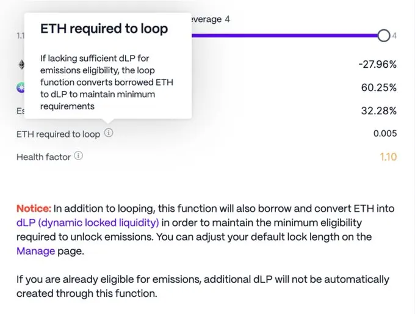
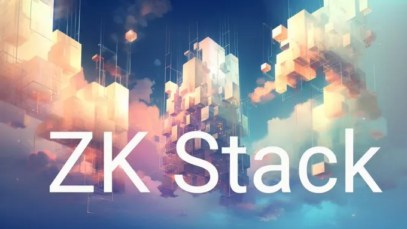
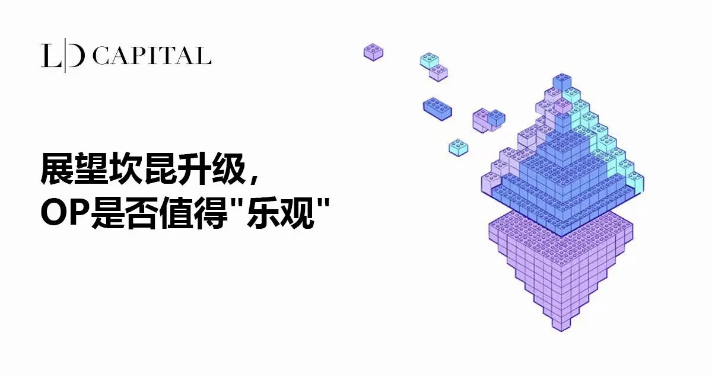
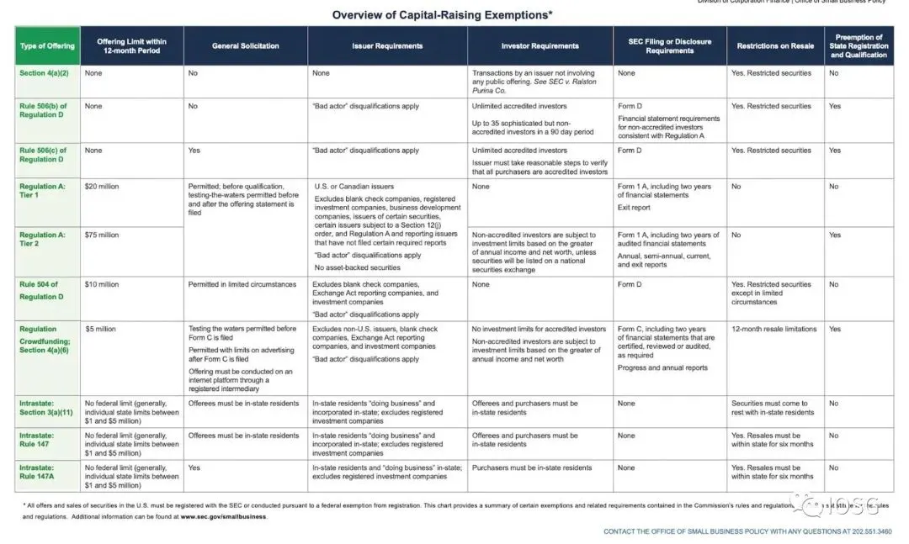
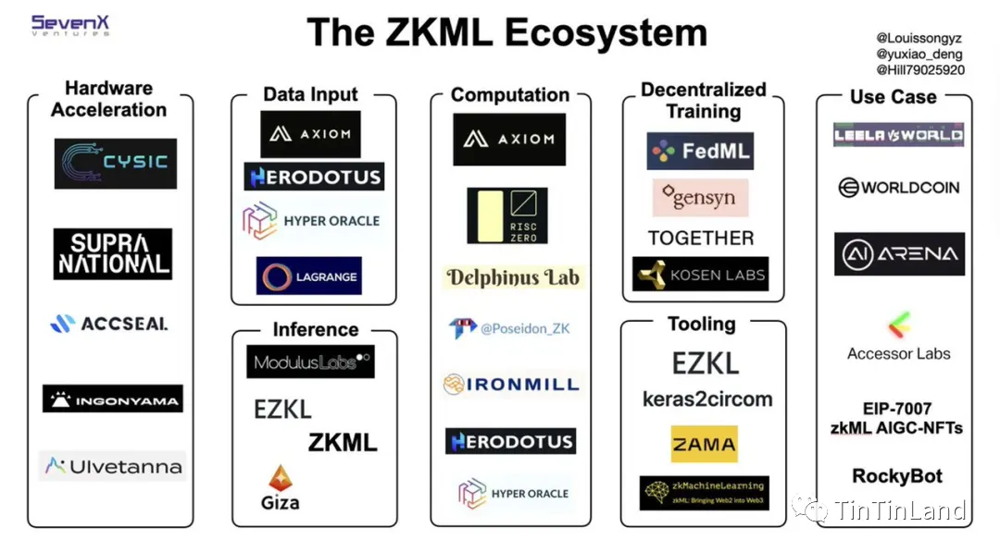
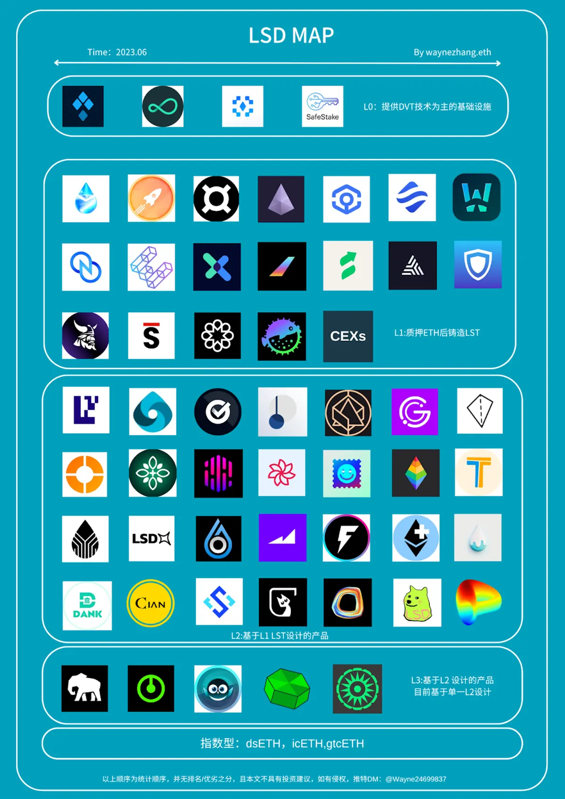
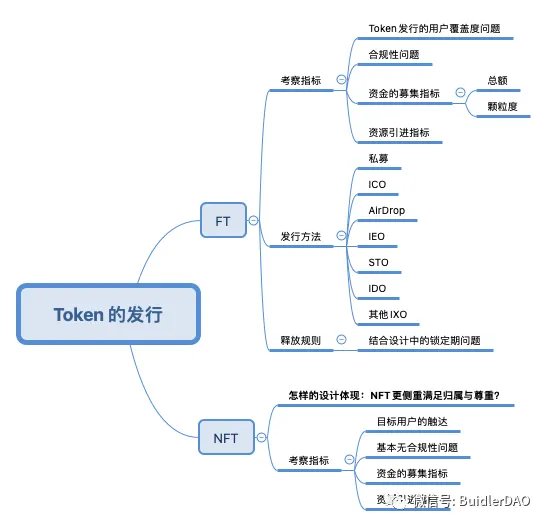

## 專案分析

- Radpie：即將推出的 RDNT 的 “Convex”
- 一文探討 ZK Stack 的模塊化野心

## 觀點剖析

- 智能合約權限衝突（SCAC）：區塊鏈穩定性的新威脅
- 展望坎昆升級，OP 是否值得 “樂觀”
- 量化與定性分析：解讀代幣和協議的價值
- IOSG：Web3 遊戲如何在 SEC 的刀尖下起舞
- 一覽零知識機器學習 ZKML 的優勢和挑戰

## 市場分析

- 多維度解析 LSD MAP 2.0，思考及行動指南
- 深度解析 Token 發行：初始發行方式對比分析及總結

## 熱門事件

- 血賺 20000 ETH 的 Azuki 為何這次惹怒了整個社群

---

## Radpie：即將推出的 RDNT 的 “Convex”

本文介紹了 Magpie 推出的第二個 subDAO－Radpie，並探討 Radpie 是否能複制或超越 Penpie 的收益。Radpie 之於 Radiant 就像 Convex 之於 Curve 一樣，Radpie 透過募集 dLP 並共享給 DeFi 礦工來突破原先 Radiant 的挖礦限制措施，這樣的機制和 Convex 十分相似。Radpie 的優勢在於能夠從 Magpie 的 subDAO 和多個項目的內外循環中受益，而其缺點則在於缺乏類似Pendle/Curve 投票激勵分配的賄賂收入。

最後文章也說明如何參與 Magpie IDO，包括長期持有 vlMGP 和短期套利參與 mDLP Rush 活動，將 DLP 轉為 mDLP。Radpie 作為 RDNT 的 Convex，在低估值和借助 Magpie 力量的部分具有其優勢，並且擁有 LayerZero、ARB 空投、超主權杠杆治理、內外雙循環、subDAO 這 5 大敘事，因此可以期待其未來的巨大發展潛力。

[https://panewslab.com/zh\_hk/articledetails/0i9if6foo18k.html](https://panewslab.com/zh_hk/articledetails/0i9if6foo18k.html)

## 一文探討 ZK Stack 的模塊化野心

繼 OP Stack 和 Arbitrum Orbit 發布之後，Matter Labs 也發布了 ZK Stack 的開源框架，旨在為遊戲、交易所側鏈和企業鏈等高度定制、私有化的應用生態需求提供底層架構支持，ZK 技術在帳戶抽象、異步跨鏈調用和無限擴展性的優勢，也讓建構複雜的多鏈網路增添可行性。

ZK Stack 旨在搶占 L2 和 L3 市場，它利用以太坊的高安全性和使用 ZK 證明來直接驗證狀態變更，增強交互效率，而在異步跨鏈調用方面，OP Stack 和 Arbitrum Orbit 相比之下仍存在諸多限制。不過 ZK Stack 仍需克服以太坊調用上限和系統複雜度等挑戰，才有機會能成為應用生態系的霸主。

[https://panewslab.com/zh\_hk/articledetails/mnd3dnmt.html](https://panewslab.com/zh_hk/articledetails/mnd3dnmt.html)

## 智能合約權限衝突（SCAC）：區塊鏈穩定性的新威脅

文中作者提到目前公共區塊鏈雖然不受國家和私人控制，但節點和運營者仍受其所在國家的法律約束，因此智能合約執行的行爲雖然現在在是合法的，但可能之後會因法律的制定或變更變成非法，這時就會產生「智能合約權限衝突」（SCAC）的狀況。

為了避免法律責任，節點會開始辨識非法交易並拒絕處理它們，但是當這些非法交易被非違法的其他地區節點打包成區塊時，參與驗證含非法交易區塊的當地節點則會面臨違法危機。

作者認為解決的方法包含讓節點有權標記出問題交易並投票 ”present" 來避免受到鏈上懲罰，或是透過制定規則來讓 51% 的節點標記出特定交易時，該交易就會被拒絕並從交易池中移除。不過未來若不解決 SCAC 問題的話，它仍會對任何出現此狀況的區塊鏈穩定性造成持續性的威脅。

[Smart Contract Authority Conflicts（Stanford Blockchain Review）](https://review.stanfordblockchain.xyz/p/smart-contract-authority-conflicts)

## 展望坎昆升級，OP 是否值得 “樂觀”

本文主要介紹了 OP Mainnet 的發展歷程、技術優勢和未來發展計劃。 OP Mainnet是一種基於以太坊的二層擴容解決方案，旨在解決以太坊網絡的性能瓶頸和高昂的交易費用問題。文中介紹了 OP Mainnet 的特點和優勢，包括快速的交易處理、低 gas 費用以及與以太坊的兼容。OP Mainnet 也因為深度參與 EIP-4844 的推進，因此在坎昆升級後也能夠更好的適配來降低 gas 費用。

雖然 OP Mainnet 目前仍有排序器中心化、欺詐證明失效以及網路生態活耀度低落等問題，但 OP Mainnet 仍持續推進技術創新及升級，除了目前已有 Coinbase 和 Binance 採用 OP Stack 來建構其生態，OP Mainnet 也計劃在 2023 年完成下一代故障證明 Cannon 的升級，接下來或許可以持樂觀態度看待 OP Mainnet 未來的發展。

[https://ld-capital.medium.com/展望坎昆升级-op是否值得-乐观-f4606a3744c2](https://ld-capital.medium.com/%E5%B1%95%E6%9C%9B%E5%9D%8E%E6%98%86%E5%8D%87%E7%BA%A7-op%E6%98%AF%E5%90%A6%E5%80%BC%E5%BE%97-%E4%B9%90%E8%A7%82-f4606a3744c2)

## 量化與定性分析：解讀代幣和協議的價值

本文主要探討哪些定量組成能夠對資本資產價值進行有效評估，並列舉這些定量組成詳細說明。首先可以透過總鎖定價值（TVL）來衡量 DeFi 協議在安全性與使用上的價值，而用戶數量及協議收入則可用於了解協議的市場適應能力以及盈利能力。另外也可透過市值/鎖定總價值（MC/TVL）、價格/銷售額（P/S）和價格/費用比（P/F）等比率來進一步評估代幣的價值。

最後作者強調在分析這些數據時，應該權衡每個因素的適用性，並與定性組成部分（社群、敘事、代幣功能）相結合去做評估。對於創業者來說，完善的結合定性和定量組成能夠更好的展示其產品的價值，並帶給用戶更具說服力的證明。

[https://www.techflowpost.com/article/detail\_12308.html](https://www.techflowpost.com/article/detail_12308.html)

## IOSG：Web3 遊戲如何在 SEC 的刀尖下起舞

本文主要討論 Web3 遊戲在美國所面臨的監管挑戰以及如何從產品設計、商業模式搭建、運營和發行等方面來應對。文中透過一些示例來說明遊戲開發者如何避免讓遊戲代幣被歸類為證券並能夠符合監管要求，作者認為遊戲在發行代幣時也須考量代幣的存在性以及代幣的真實購買者是否為玩家等面向。

作者認為未來遊戲團隊應該要更注重在監管的風險上，並關注專案的去中心化程度，因為這在監管的環境下會是相應的安全防護罩。最後作者也提到 Web3 遊戲應該注重在創新上，而非只依賴於 Game-fi 模型，獨特且引人入勝的遊戲體驗才是可能讓遊戲長期發展的主要因素之一。

[https://mp.weixin.qq.com/s/dEZdKYcV8ESSGLrLlul-UA](https://mp.weixin.qq.com/s/dEZdKYcV8ESSGLrLlul-UA)

## 一覽零知識機器學習 ZKML 的優勢和挑戰

本文主要討論關於區塊鏈技術 ZK 和機器學習 ML 結合的可能性與未來發展。ZKML 結合了零知識證明的隱私保護和驗證能力，以及機器學習的數據處理和決策能力，並為數據隱私保護、驗證模型準確性和提高計算效率提供了解決方案。不過區塊鏈算力低下的問題，也成為 ML 上鏈的最大阻礙，而 ZK-SNARKs 這種只需少量計算即可驗證證明有效性的特點，能夠符合 ML 的鏈上算力需求，因此 ZKML 的 ZK 通常是以 ZK-SNARKs 為主。

除了 ZK 能夠為 ML 賦能來解決信任證明的問題之外，ML 也能為 ZK 賦能帶來更豐富的 Web3 應用場景，雖然 ZKML 仍有參數失真和大模型的高算力需求等問題存在，不過依然可以預見 ZKML 將會成為 Web3 和 AI 的絕佳交會點，並為區塊鏈的未來帶來更多想像空間。

[https://panewslab.com/zh/articledetails/ds3wj6ta7ty1.html](https://panewslab.com/zh/articledetails/ds3wj6ta7ty1.html)

## 多維度解析 LSD MAP 2.0，思考及行動指南

文中作者透過將目前 LSD 相關的協議區分成四個層級，並對這四個層級的現況進行分析。他認為第一層以 DVT 為技術基礎的協議擁有其技術壁壘，但代幣的實際效用仍需詳細考量；第二層的 LST 發行商已被 Lido 和 Rocket protocol 佔據多數份額，其他協議已無太多的成長空間；基於 LST 所設計的第三層協議多數並不具有護城河，主要得看團隊的業務發展能力；以第三層為基礎的第四層協議其市值與流動性受限於第三層的發展，需要較長的時間才能發展起來。

最後作者提到目前 LSD 市場與當時的 DeFi summer 相比多了許多其他賽道來瓜分市場的流動性，因此他認為未來 LSD 真正的 summer 應該會跟牛市一起到來，不過面對這麼多的協議，最重要的還是要謹慎選擇，以免在牛市到來前就先被市場淘汰。

[https://www.techflowpost.com/article/detail\_12266.html](https://www.techflowpost.com/article/detail_12266.html)

## 深度解析 Token 發行：初始發行方式對比分析及總結

本文主要圍繞 Token 的發行進行討論，並就 Token 的類型和經濟模型設計進行說明。文章中提到兩種 Token 發行的類型標準，一種是初始流通量為 0 的固定總量通證模型，另一種則是初始總量不為 0，需要藉助 Token 發行來籌集資金或更精準的觸達用戶的通證模型。

作者也針對各種代幣發行方式如：ICO、IEO、IDO 等類型進行說明，並詳細分析其優缺點，透過作者整理的表格，除了可以清楚了解不同代幣發行模式在用戶覆蓋度、合規性和籌集資金等屬性上的差異，協議也能進一步衡量不同發行方式所帶來的效益與市場的適配性。

[https://www.techflowpost.com/article/detail\_12326.html](https://www.techflowpost.com/article/detail_12326.html)

## 血賺 20000 ETH 的 Azuki 為何這次惹怒了整個社群

Azuki 近日發布其醞釀一年的新系列作品 Azuki Elemental，卻引發了社群的怒吼。原因歸咎於許多用戶認為這次的 Elemental 系列圖片與原系列幾乎相同，毫無創新之處，並且認為 Azuki 團隊只是想藉此再次牟利，而 Azuki 團隊也在發售結束後迅速轉出募集來的 2 萬枚 ETH，這樣的舉動更加深了用戶的不滿。

也因為對團隊的失望和憤怒，許多 Azuki 持有者紛紛出售他們手中的 Azuki NFT，造成 NFT 價格全面下跌。Azuki 團隊在這一次發售行動中除了傷害了用戶的信任與期待，也讓原本有機會重新點燃 NFT 市場的火把又再度被澆熄。雖然後續 Azuki 官方已預告可能會有相對應的補償措施，但被傷害的 Azuki 信仰者能否願意繼續支持，就看 Azuki 官方是否夠有誠意來亡羊補牢了。

[https://www.odaily.news/post/5188038](https://www.odaily.news/post/5188038)

## 結尾

感謝您閱讀本篇文章，希望本文的內容能夠對您有所啟發和幫助。

如果您對區塊鏈出圈科普知識感興趣，請搜索 🔍 **[WalkinCat 走路貓](https://portaly.cc/walkincat)**，了解更多相關資訊。如果您想繼續關注我們的最新文章，歡迎訂閱我們的電子報，或透過以下連結找到我們。我們期待您的想法和反饋，謝謝您的支持！
