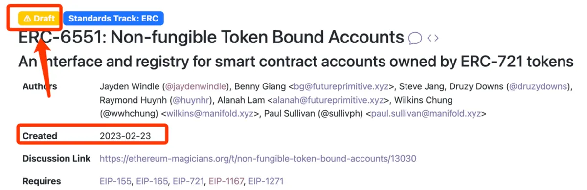
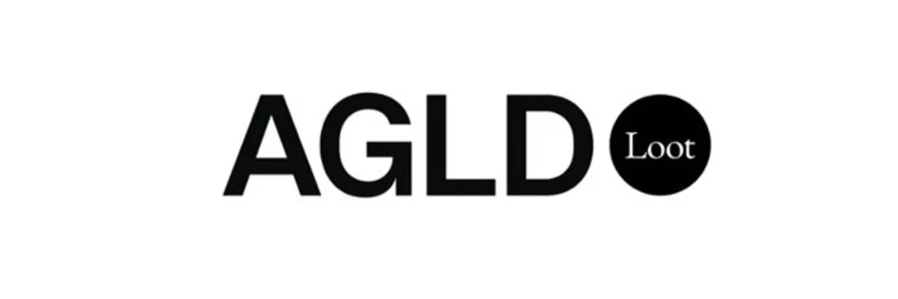
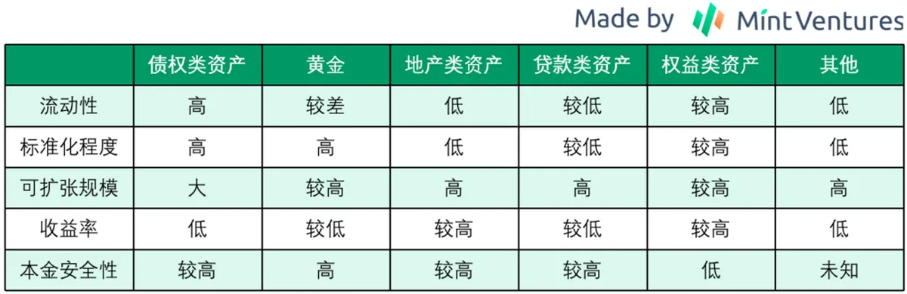
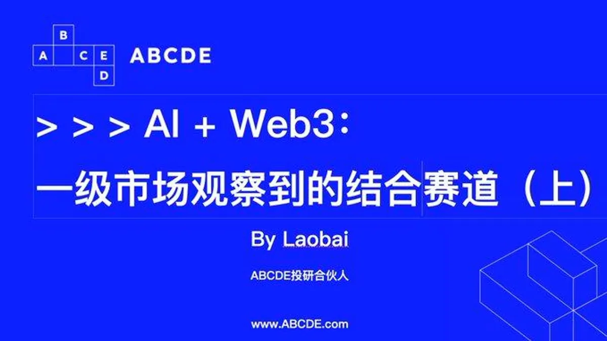
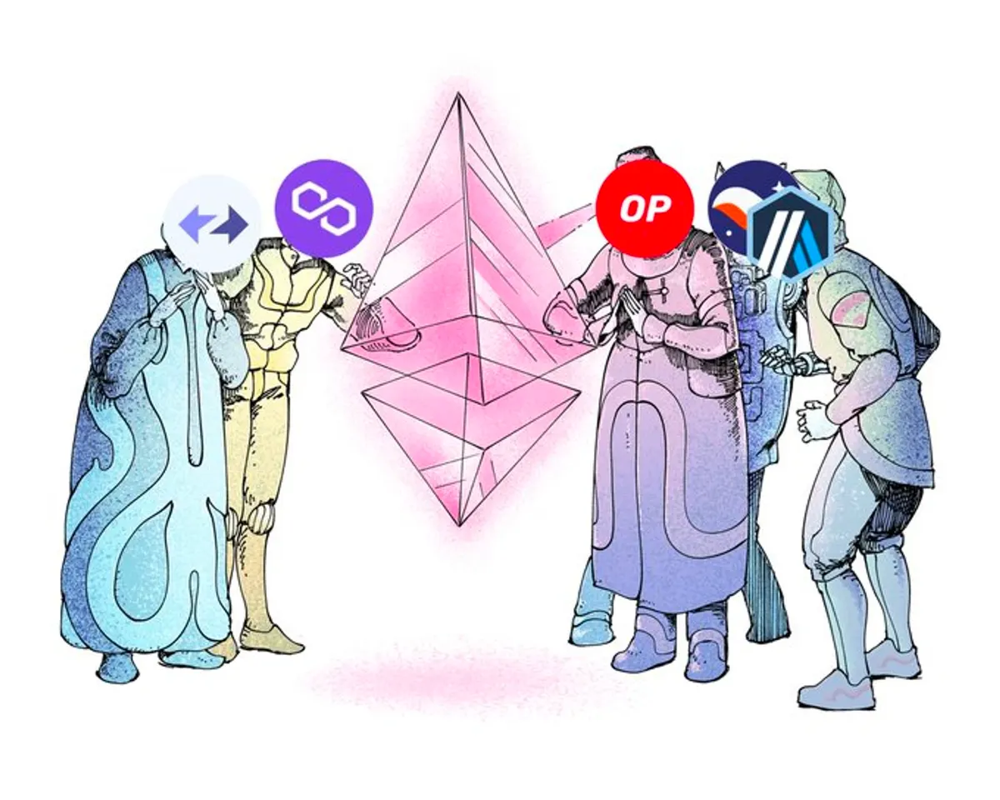
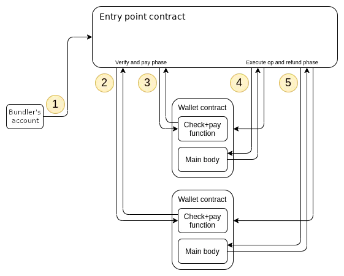
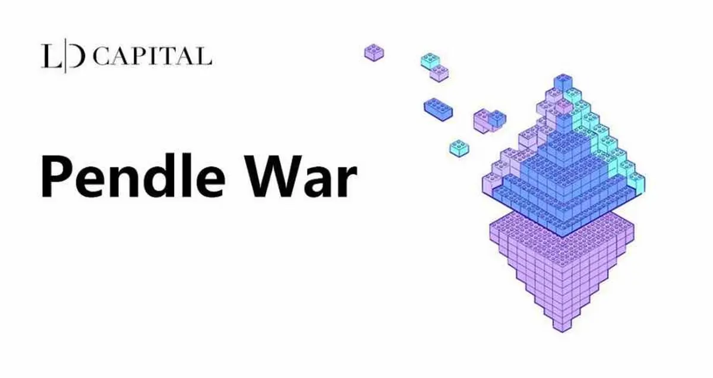
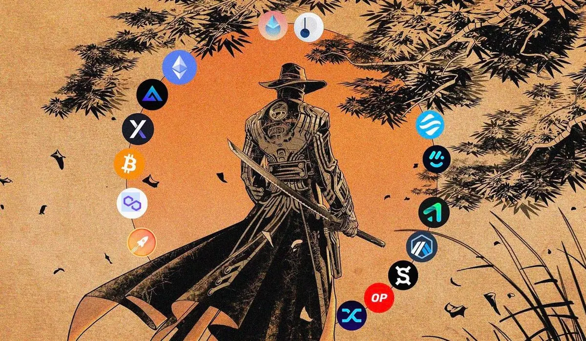

## 專案分析

- ERC-6551 代幣綁定帳戶：讓 NFT 擁有自己的錢包成爲可能
- 從文本 NFT 到 L2 網路 Loot Chain，Loot 要講述什麼新故事？

## 觀點剖析

- 深入 RWA：底層資產、業務結構、發展路徑與潛在機遇
- AI + Web3：一級市場觀察到的結合賽道（上）
- 一文概覽以太坊擴展解決方案的演變
- 基礎設施如何透過帳戶抽象為數十億用戶提供支持
- 熊市終結的幻象：為何我們常常錯估市場訊號

## 市場分析

- 數據分析：Pendle War 將如何展開？
- 第三季度值得關注的 9 個催化劑

## 熱門事件

- Threads 初體驗：這款 “Twitter 殺手” 到底好不好用？

---

## **ERC-6551 代幣綁定帳戶：讓 NFT 擁有自己的錢包成爲可能**

ERC-6551 在加拿大滑鐵盧的 ETHGlobal Waterloo 黑客松中備受關注，11 個進入決賽的專案中就有 4 個和這個協議相關，ERC-6551 可以為每個 ERC721 類型的 NFT 創建智能合約帳戶，使其具備可組合性、擁有 NFT 與 Token 資產和與 DApp 交互的功能。

ERC-6551 擁有無需許可（permission）和向前兼容的特性，因此可以對現有的 NFT 進行改造，也解決了以往協議只能修改相應程式碼，而無法對現有 NFT 進行改造的問題。或許是因為近期 NFT 市場的低迷，才讓 ERC-6551 在推出後幾個月再度受到市場關注，期待未來 ERC-6551 能夠成為重新點燃 NFT 領域的新火種。

[https://www.techflowpost.com/article/detail\_12359.html](https://www.techflowpost.com/article/detail_12359.html)

## **從文本 NFT 到 L2 網路 Loot Chain，Loot 要講述什麼新故事？**

文中介紹了 Loot chain 的創建成因以及 Loot 生態的發展過程，起源於 Loot 社區的 Adventure Gold DAO（AGLD）為了改善以太坊網路上高昂的 Gas 費對 Lootverse 發展的阻礙，因此宣布使用 OP Stack 來建立自己的 L2 網路 Loot Chain，並且採用 $AGLD 作為 Gas 代幣以及治理代幣。

AGLD 為了實現建構自治世界的最終目標，以及延續 Lootverse 的發展，未來 AGLD 將會基於 Loot Chain 開發 NFT 以及全鏈遊戲，並且提供開發工具包和其他配套產品來促進 Lootverse 生態的發展，Loot chain 這個以 NFT 社區的專有鏈或許可以借鑑 Ronin 的成功，成為鏈遊領域的後浪，並為建設 Lootverse 的自治世界邁出重要的一步。

[https://panewslab.com/zh\_hk/articledetails/l02m51cq.html](https://panewslab.com/zh_hk/articledetails/l02m51cq.html)

## 深入 RWA：底層資產、業務結構、發展路徑與潛在機遇

近期市場對於 RWA 的關注越來越高，許多專案也開始近入 RWA 的領域，RWA 主要是將傳統市場中的資產透過代幣的形式映射上鏈，使代幣擁有資產的收益權。RWA 除了可以引入傳統市場的低風險高收益，透過 RWA 也能夠吸引傳統市場的用戶，並為區塊鏈產業注入新的流動性。

目前市場對 RWA 的期待相對實際發展仍過於理想，作者認為 RWA 專案需要考慮到底層資產、底層資產的標準化、鏈下合作機構及合作形式，以及風險管理等問題。另外 RWA 市場的定位對於當前的用戶結構與用戶需求來說並無法滿足用戶的收益期待值。

不過 RWA 因為具有法幣本位的低風險投資標的、資產風險分散化以及對抗本國貨幣波動這三種特性的優勢，在未來監管框架更為明確的情況下，更多的流動性將可能進入加密市場，並讓整個加密產業進入新一個層級的蓬勃生長期。

[https://www.techflowpost.com/article/detail\_12384.htm](https://www.techflowpost.com/article/detail_12384.html)

## AI + Web3：一級市場觀察到的結合賽道（上）

作者觀察到過往結合 AI 和 Web3 的專案主要都是平台類型，不過現階段這些平台類的專案有較多的包袱在，對於未來的發展並不夠樂觀，目前常見的 AI+Web3 賽道集中在 Bot/Agent/Assistant 資產模型化、算力平台、數據平台、生成式 AI、DeFi 交易/審計/風控，以及 ZKML。

文中針對 Bot/Agent/Assistant 資產化的領域進行剖析，這種利用 OpenAI 等技術堆疊出的特定領域專業性服務專案，其弊端除了同質化嚴重之外，用戶也並非得用 Web3 的 bot 來達成其目的。

最後作者認為未來模型上鏈和機機交互的模式很可能是之後的發展方向，而 AI 與 Web3 的結合也將逐漸模糊 Web2 和 Web3 的邊界。

[https://twitter.com/Wuhuoqiu/status/1676817186831360001](https://twitter.com/Wuhuoqiu/status/1676817186831360001)

## **一文概覽以太坊擴展解決方案的演變**

本文主要介紹以太坊擴展的未來發展趨勢，以及當前 Web3 開發者所面臨的挑戰和選擇。作者提到目前開發者有三種選擇，一種是直接在以太坊上部署，另一種是選擇 L2 作為解決方案，最後一種則是部署自己的鏈。不過不管是哪種選擇，如何實現互操作性仍是開發者需面對的重要挑戰。

作者也針對以太坊上主要的擴展解決方案說明其架構及技術型態，這些擴展解決方案所提供的新技術將讓開發者擁有更多的選擇和自由度，不過這些 L2 擴展方案誰能真正獲得開發者的青睞，還有待後續的觀察。

[https://panewslab.com/zh/articledetails/ss8hvsg9.html](https://panewslab.com/zh/articledetails/ss8hvsg9.html)

## 基礎設施如何透過帳戶抽象為數十億用戶提供支持

本文從基礎設施服務提供商的角度來探討帳戶抽象對用戶體驗和區塊鏈使用門檻的影響，文章中除了介紹帳戶抽象概念的起源以及現階段用戶 EOA 帳戶所存在的問題，也針對帳戶抽象的主要協議 EIP-4337 進行其機制與協議中各角色的說明。

不過目前帳戶抽象仍處於早期發展階段，實際採用的情形少之又少，並且執行的過程中仍有一些問題尚待解決，例如同一個 UserOperation 同時被不同的 Bundlers 提交到出塊節點，或是 AA 中的 MEV 發展方向。未來這些基礎設施服務商須透過優化 Bundler 的服務和集成 Paymaster 來適應帳戶抽象的大規模採用，並提供更多元的用戶體驗來減少用戶使用上的心理摩擦。

[https://www.panewslab.com/zh/articledetails/24hz8399g6my.html](https://www.panewslab.com/zh/articledetails/24hz8399g6my.html)

## 熊市終結的幻象：為何我們常常錯估市場訊號

推文中作者教我們如何判斷市場是處在真正的牛市狀態還是只是牛市的陷阱中，通常身處牛市時，會有幾個指標可以作為判斷依據，包括持續的價格增長、交易量增加、正向的新聞事件、穩定的發展、增加的社會情懷。

而牛市陷阱主要是由缺乏動能或流動性所引起，因此牛市陷阱的潛在訊號包括缺乏價格上漲的基本支撐、缺少正面消息、交易量顯著減少，以及價格突破時的少量交易量。當市場看似回暖時若能提早從這些訊號中判讀出市場狀態，將能夠減少落入牛市陷阱的機會，並守住自身的資產價值。

[https://twitter.com/Haylesdefi/status/1672640420277284866](https://twitter.com/Haylesdefi/status/1672640420277284866)

## 數據分析：Pendle War 將如何展開？

本文透過數據說明關於 Pendle Finance 協議的情況，Pendle Finance 是以太坊和 Arbitrum 上的收益策略協議，其 TVL 從 2022 年底更新 V2 後就開始持續增長，目前已經突破 1.26 億美元。Pendle 協議採用 veToken 和 Gauge 的投票模式來進行流動性挖礦，因此 Pendle LST 池收益率可達到 10%-30%。

文章中也針對兩個 Pendle 的輔助協議 Penpie 和 Equilibria 進行分析，兩者皆在 Pendle 的 veToken 經濟模型基礎上提高了 LP 的收益，在協議收益分配上可以看出，Penpie 給的 LP 收益比例比 Equilibria 來得高，因此擁有較佳的優勢來吸引用戶。

雖然 Pendle 目前看來正在穩步成長中，不過也因為 PENDLE 代幣的持續發放，無法吸引用戶持續質押其 PENDLE，進而存在潛在的賣壓，投資者必須考量到這個風險才能做出明智的投資決策。

[https://www.techflowpost.com/article/detail\_12378.html](https://www.techflowpost.com/article/detail_12378.html)

## 加密市場第三季度值得關注的 9 個催化劑

文章首先針對第二季度主要的協議進行回顧與數據分析，並比較各鏈之間的盈利狀況，作者也列舉了 9 個市場接下來重要的敘事場景，並一一說明其值得關注的敘事點，包括比特幣 ETF、EIP-4844、流動性質押與 LSDfi、Base、Frax chain、Polygon 2.0、dYdX V4、GMX V2、Synthetix V3。

其中作者認為比特幣 ETF 會是最主要推動市場的因素之一，若接下來比特幣 ETF 能獲得 SEC 批准，除了大型機構能夠接觸到這類資產外，也能夠因為市場成長而為 DeFi 中的其他敘事場景注入更多的流動性。雖然上個季度因為大型交易所面臨 SEC 訴訟以及 USDT 脫鉤的事件，導致市場迅速掉入 FUD 的情緒中，不過接下來的市場敘事或許將重新帶領加密領域回到曾經的高光時刻。

[https://www.techflowpost.com/article/detail\_12403.html](https://www.techflowpost.com/article/detail_12403.html)

## Threads 初體驗：這款 “Twitter 殺手” 到底好不好用？

Threads 是 Meta 旗下一款基於文字對話的應用程式，與 Twitter 十分相似，兩者的差異在於 Threads 可以將帳戶設置為私密帳戶，或是隱藏讚數，並且可以全螢幕的瀏覽圖片和保存圖片。

不過目前在 Threads 內要更改用戶名，或是切換不同帳號時都必須到 Instagram 去做設定，在用戶體驗上仍有些許不便，也因為 Threads 直接綁定 Instagram 來承接用戶，對於沒有使用 Instagram 的使用者來說並不夠友善。雖然 Threads 作為市場的後進者，但未來能否憑藉 Instagram 的廣大用戶來鯨吞掉 Twitter 建立起的社群王國，仍有待使用者給出最終答案。

[https://panewslab.com/zh\_hk/articledetails/81dzy49b.html](https://panewslab.com/zh_hk/articledetails/81dzy49b.html)

## 結尾

感謝您閱讀本篇文章，希望本文的內容能夠對您有所啟發和幫助。

如果您對區塊鏈出圈科普知識感興趣，請搜索 🔍 **[WalkinCat 走路貓](https://portaly.cc/walkincat)**，了解更多相關資訊。如果您想繼續關注我們的最新文章，歡迎訂閱我們的電子報，或透過以下連結找到我們。我們期待您的想法和反饋，謝謝您的支持！
