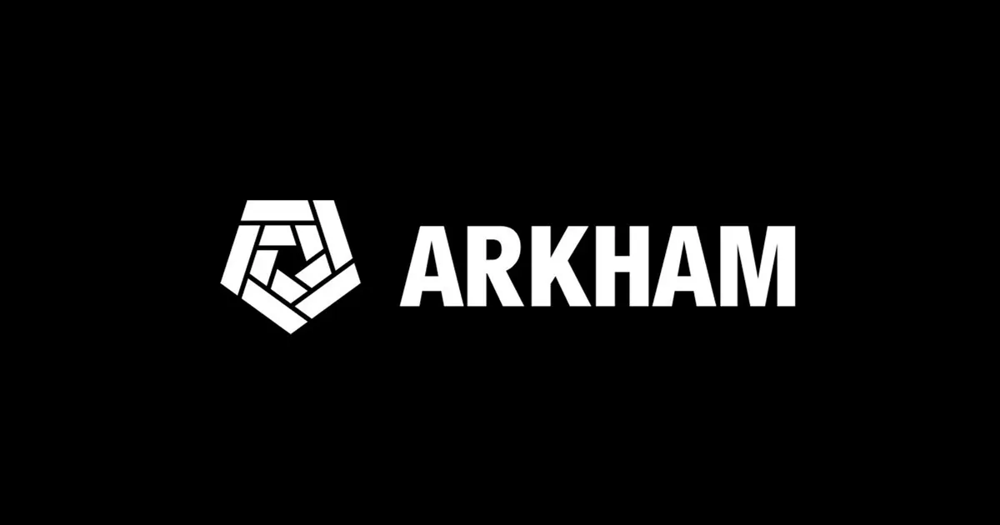
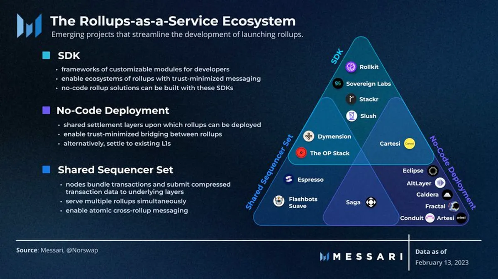
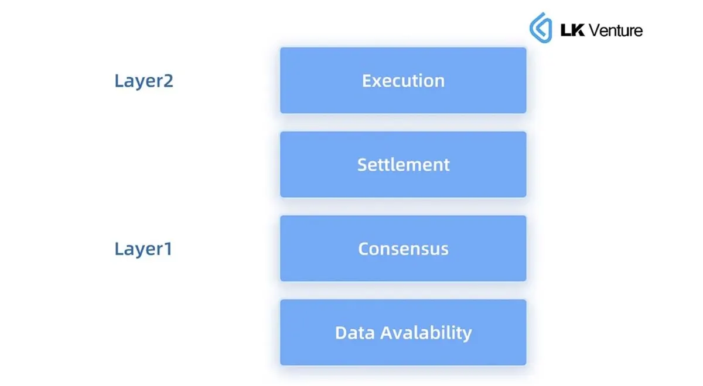
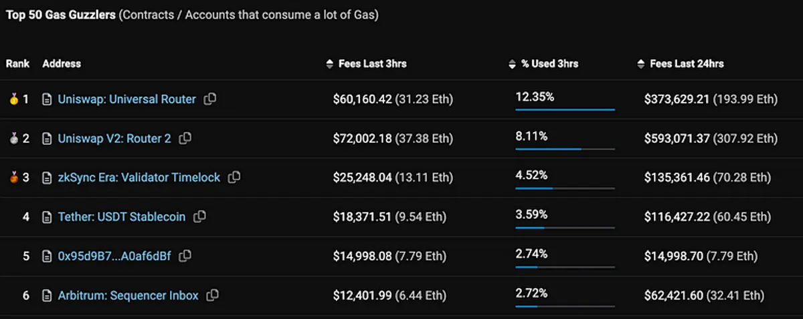
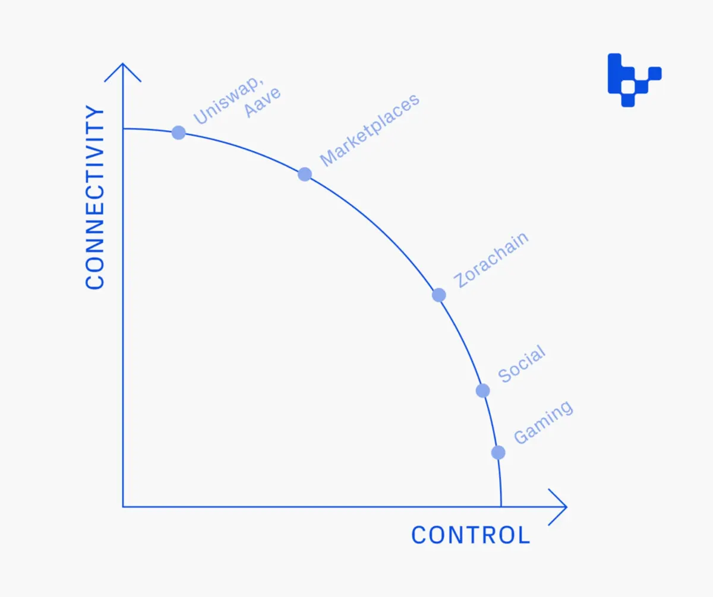
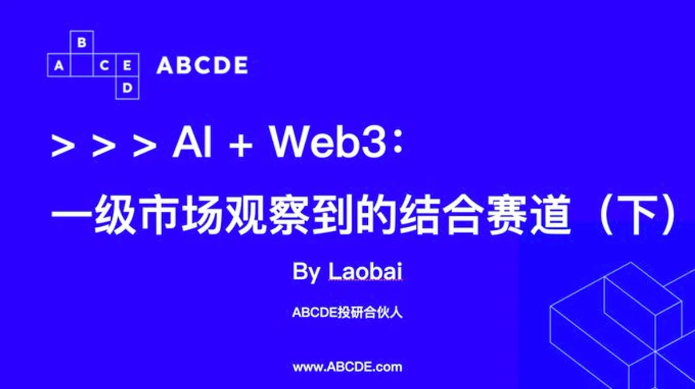
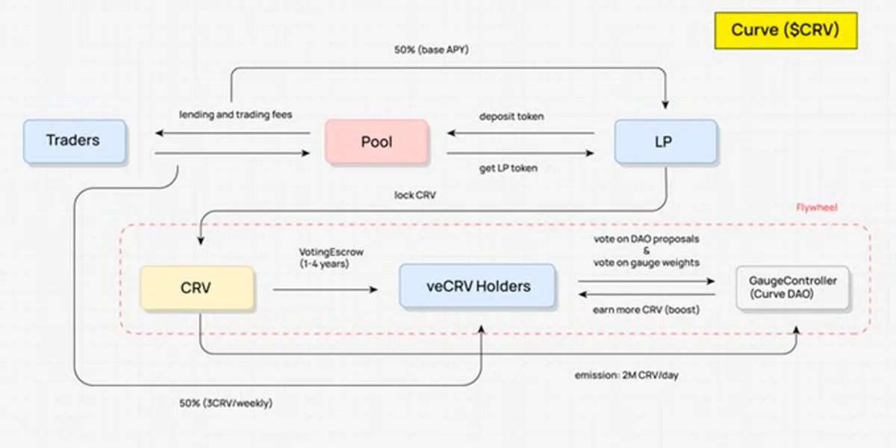
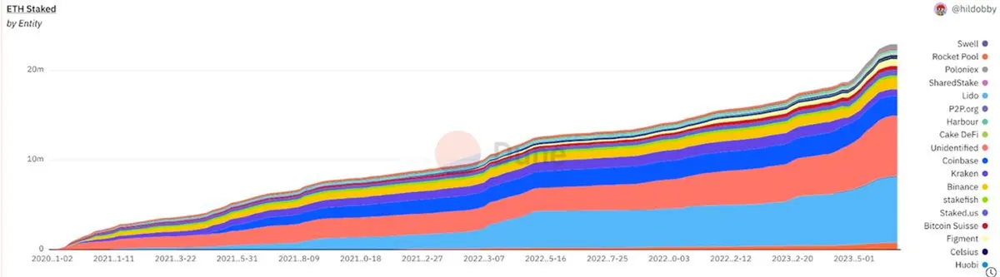
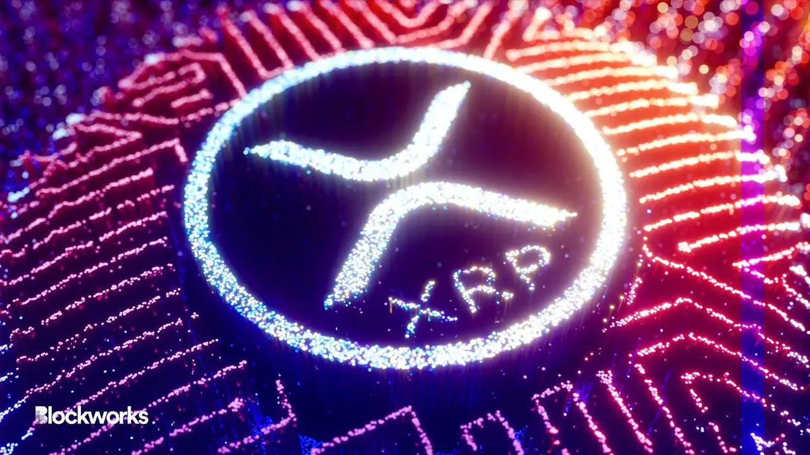

## 專案分析

- Arkham：幣安最新 Launchpad 或成隱私洩露黑洞？

## 觀點剖析

- Rollup as a Service：區塊鏈擴容新局面，下一個模組化戰場
- 有了 Layer2，為何還需要 Layer3？
- 以太坊新數據經濟解讀：「臨時數據」新時代及數據維護新經濟可能性
- 特定應用 Rollups：連接性與控制性之間的權衡
- AI+Web3：一級市場觀察到的結合賽道（下）

## 市場分析

- 深入剖析 4 個經典的代幣經濟模型
- LSD 競爭者：挑戰 Lido 龍頭地位的五大新秀

## 熱門事件

- FTX 客戶索賠網站使用教學！如何提交索賠證明、確認餘額？哪些細節需注意？
- 瑞波與 SEC 的判決結果出爐，勝訴後的市場將如何跨出下一步

---

## Arkham：幣安最新 Launchpad 或成隱私洩露黑洞？

幣安宣布上線其最新的 Launchpad 專案 Arkham，它是一個鏈上的數據分析平台，除了可以針對機構、交易所、鯨魚等錢包進行分析，也可以查看不同專案的持有者、交易流量以及交易活動，並且透過可視化的工具，用戶可以更清楚的了解不同地址間的關係與連結。而 Arkham 最為核心的功能就是 Intel Exchange，透過提供情報交易的平台來滿足鏈上情報交換的需求關係。

不過有許多人認為這樣的平台是在挑戰區塊鏈對於隱私為首的價值觀，建立匿名人肉市場機制將會讓人為了利益而竭盡全力挖掘別人的隱私，不過可以思考的是，如果利益就在你面前時，我們是否會讓隱私也淪為理想但又虛幻的口號。

[https://www.panewslab.com/zh/articledetails/ja9ee6jq.html](https://www.panewslab.com/zh/articledetails/ja9ee6jq.html)

## Rollup as a Service：區塊鏈擴容新局面，下一個模組化戰場

文章中詳細說明何謂 RaaS 以及 RaaS 所面臨的挑戰與機會，隨著以太坊生態的發展，多樣化的擴容解決方案應運而生，目前多數的解決方案為鏈下擴容，而 Rollup as a Service（RaaS）為鏈下擴容提供一種定制化 Rollup 的服務，透過可以簡易部署和提供開發工具來滿足開發者的特定需求。

目前 RaaS 的專案大致分為 SDK、無代碼方案和共享排序器這三種類型，文中也針對這些類型進一步展開說明，不過這些致力於 RaaS 的產品都為用戶提供了友好、高效和易用的 Rollup 部署方式，雖然 RaaS 仍有許多挑戰需要被克服，但它也為區塊鏈的生態擴展注入重要的養分。

[https://panewslab.com/zh/articledetails/vuvlnozu.html](https://panewslab.com/zh/articledetails/vuvlnozu.html)

## 有了 Layer2，為何還需要 Layer3？

本文針對不同 Layer 間的差異及應用生態進行深入探討，作者說明 Layer1 到 Layer2 的擴容緣由以及 Optimistic Rollup 和 ZK Rollup 間的區別。而 Layer2 走向 Layer 3 則是為了客製化而非無限擴容，透過將 Layer3 作為應用特定鏈來滿足 Layer2因通用性而無法滿足特定需求的缺點。

同樣作為應用鏈生態的 Cosmos 和 Layer3 所帶來的功能幾乎相同，最大的差別在於是否與以太坊生態綁定。當前 Arbitrum Orbit Chain、ZK Stack、Starknet 在 Layer3 上都還在積極發展中，不過作者認為 Layer3 或許得等到區塊鏈技術大規模採用時，才有可能獲得更多的用戶使用，樓起後如何吸引人流，才是未來最需要思考的議題。

[https://www.techflowpost.com/article/detail\_12460.html](https://www.techflowpost.com/article/detail_12460.html)

## 以太坊新數據經濟解讀：「臨時數據」新時代及數據維護新經濟可能性

本文藉由坎昆升級的核心協議 EIP-4844 延伸對於以太坊上數據議題的探討。EIP 4844 的目的在於降低以太坊 L2 的費用，透過改變 L2 在主網上的數據編碼方式來達到降低費用的效果，並且採用新的交易類型 blobs 來引入暫存數據的概念。

後續將會被採納的 EIP-4444 和狀態到期的升級，作者也進一步探討數據儲存的挑戰以及可能帶來的數據經濟。未來在維護歷史與狀態數據上，可以透過集中式服務（Etherscan）、激勵分散式數據保存以及狀態恢復服務這幾個方式來進行區塊鏈數據的管理，未來除了暫存數據時代的到來，也將開啟以太坊上另一個新的數據經濟市場機會。

[https://medium.com/etherscan-blog/ethereums-new-data-economy-78511cad22c2](https://medium.com/etherscan-blog/ethereums-new-data-economy-78511cad22c2)

## 特定應用 Rollups：連接性與控制性之間的權衡

過去開發人員在部署應用程式時只需在不同的 L1 中做選擇，不過現在因為擁有更多不同的選擇，反而需要思考更多層面，包括是否要部署到通用的 Rollup、通用的 Rollup 類別怎麼選，或是要構建自己的特定應用 Rollup 等等的問題。

因此文章中說明了開發人員在決定是否啟動自己的 Rollup 時應如何做決策，以及哪些類型的應用程式會是適合的。若是比較偏重於連接性的話，應用可以共享同一個生態的流動性；而偏重於控制性的話，則能夠在用戶體驗上有更高的表現，因此須充分考量兩種特性的優缺點，團隊才能做出更好的決策，並達到更好的應用生態啟動。

[https://variant.fund/articles/app-specific-rollups-trade-off-connectivity-control/](https://variant.fund/articles/app-specific-rollups-trade-off-connectivity-control/)

## AI+Web3：一級市場觀察到的結合賽道（下）

本文作者接著說明前篇文章提到的另外 5 個 Web3+AI 的賽道：算力平台、數據平台、生成式 AI、DeFi 交易/審計/風控以及 ZKML。

其中作者認為算力平台比模型資產化賽道更好進行評估及預測。數據平台上因透過鏈上數據訓練出來的 AI 與鏈下數據訓練出來的 AI 會有所差異，因此其存在有合理性。生成式 AI 在 Gamefi 遊戲類上的應用會比 NFT 來的適合。DeFi 交易/審計/Yield/風控這些類別的同質化相對不明顯。ZKML 則還未有明確的應用場景，可能存在的剛需或許會在部分的醫療領域上。

透過了解這些賽道的現狀，我們可以很好的去對齊未來市場上出現的專案其潛力為何，以及是否有更具創新的想法來引領其賽道走進大眾的視野。

[https://twitter.com/Wuhuoqiu/status/1679370185369874433](https://twitter.com/Wuhuoqiu/status/1679370185369874433)

## 深入剖析 4 個經典的代幣經濟模型

推文中作者各別說明了代幣經濟模型中常見的的4 個類型，第一種 ve 是用戶透過鎖定代幣來換取擁有投票權和協議費用份額的 veToken；第二種 ve(3,3) 結合了 ve 的投票託管機制和（3,3）的變基質押機制，並改進協議費用的分配方法；第三種 es 引入了解鎖障礙；最後一種 lending 則是在借貸協議中用於治理和抵押。

最後作者也說明，繪製 Value Flow 可以更好地理解 DeFi 協議的代幣經濟模式，並且藉由三個問題來快速架構出專案中的經濟雛形。透過這些方式，每個人都能迅速梳理出 DeFi 協議的根本機制，並判斷不同協議間的潛力。

[https://twitter.com/dodoresearch/status/167823629312867532](https://twitter.com/dodoresearch/status/1678236293128675329)

## LSD 競爭者：挑戰 Lido 龍頭地位的五大新秀

本文介紹了 5 個在 LSD 領域中具有潛力的協議，並從許多面向探討這些協議如何透過其特點和優勢來與 Lido 競爭。Prisma 透過與 Curve 緊密結合來推動其生態的發展；Swell 提供用戶更方便的進入流程；unshETH 透過一籃子的多樣化 LSD 來激勵 LSD 領域的良性競爭；Origin Ether 透過自動化收益生成策略和質押獎勵的結合來提供高收益率；Diva 則把 LSD 的可組合性和運行自己的 ETH 節點的去中心化優勢相結合。

這些協議在回報率、易上手、更多可組合性和創新上都具有一定優勢來吸引用戶，不過目前用於質押的 ETH 比例仍較低，因此 LSD 協議依舊有機會在市場上佔有一席之地。

[https://www.techflowpost.com/article/detail\_12479.html](https://www.techflowpost.com/article/detail_12479.html)

## FTX 客戶索賠網站使用教學！如何提交索賠證明、確認餘額？哪些細節需注意？

FTX 原先於 7/12 開放用戶申請索賠，不過[索賠網站](https://claims.ftx.com/welcome)上線沒多久就無法進入，疑似因流量過載而癱瘓，不過隔天就恢復正常，用戶可以登入去確認自己的餘額及提交索賠表格。這篇文章透過一步步的流程教學，帶大家完成這些步驟，做好資產索賠的前置作業。

去年 FTX 倒閉後確實給了整個加密領域一計重擊，甚至許多人一夕之間一無所有，如今索賠網站上線，也重新帶給了大家一線曙光，不過 FTX 事件著實也讓許多人在資產的風險控管上學到了寶貴的一課。

[https://followin.io/zh-Hans/feed/5366411](https://followin.io/zh-Hans/feed/5366411)

## 瑞波與 SEC 的判決結果出爐，勝訴後的市場將如何跨出下一步

文章中概述了 SEC 和 Ripple Labs 之間長達三年的法律爭端，以及這次裁決對加密貨幣市場的影響。裁決指出，雖然 Ripple Labs 向機構銷售的行為有構成了投資契約的提供和銷售，不過法官認為絕大多數從交易所購買代幣的人，他們並沒有真正的把錢投資於 Ripple。

這個裁決也為許多代幣是否應被認定為證券的這條界線，提供了更清晰的定義。SEC 與加密產業間的法律攻防戰尚未結束，後續還有 Coinbase 和 Binance 的訴訟等著進行。不過在當前缺乏針對加密產業的立法情況下，法院提供的指引將能夠讓整個加密產業在創新以及營運上不再只能摸著石頭過河。

[https://blockworks.co/news/xrp-altcoins-pump-post-ruling](https://blockworks.co/news/xrp-altcoins-pump-post-ruling)

## 結尾

感謝您閱讀本篇文章，希望本文的內容能夠對您有所啟發和幫助。

如果您對區塊鏈出圈科普知識感興趣，請搜索 🔍 **[WalkinCat 走路貓](https://portaly.cc/walkincat)**，了解更多相關資訊。如果您想繼續關注我們的最新文章，歡迎訂閱我們的電子報，或透過以下連結找到我們。我們期待您的想法和反饋，謝謝您的支持！
