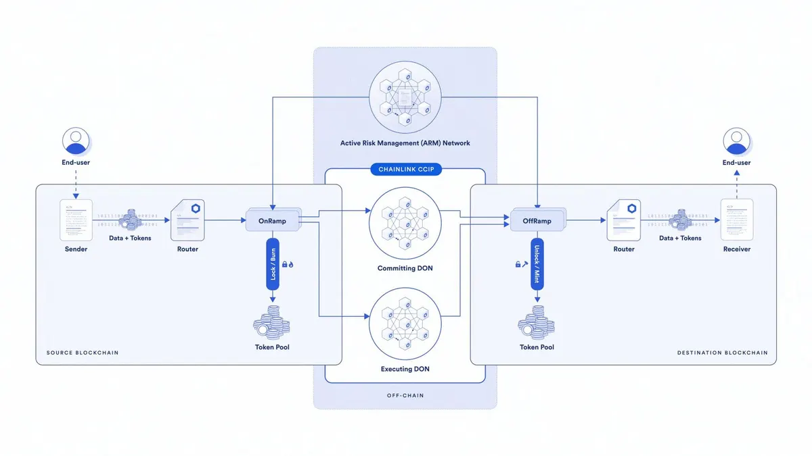
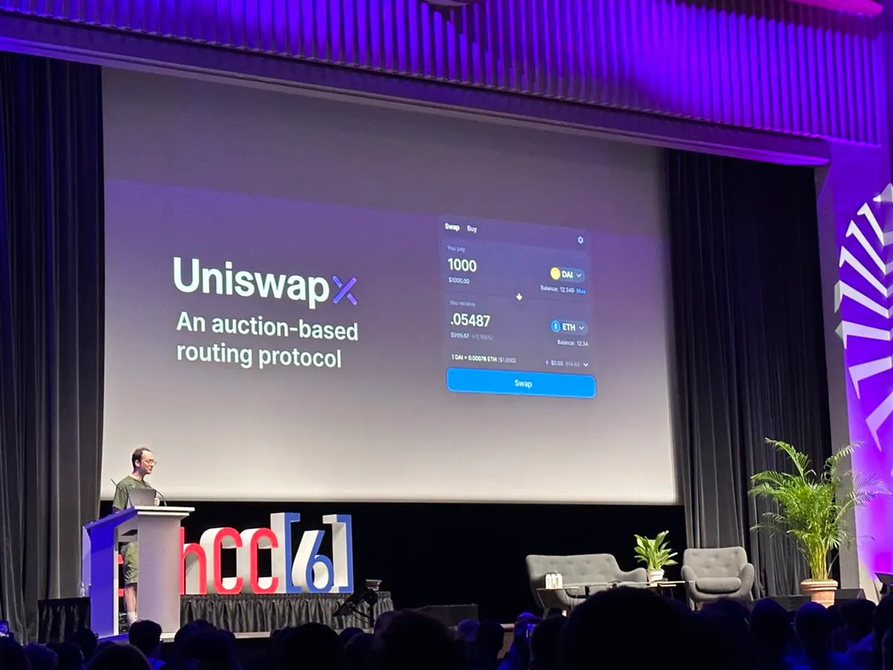
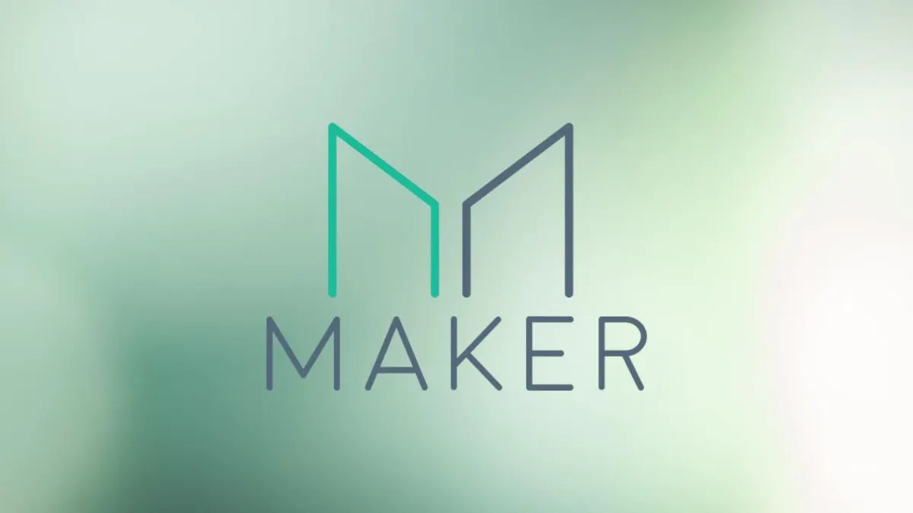
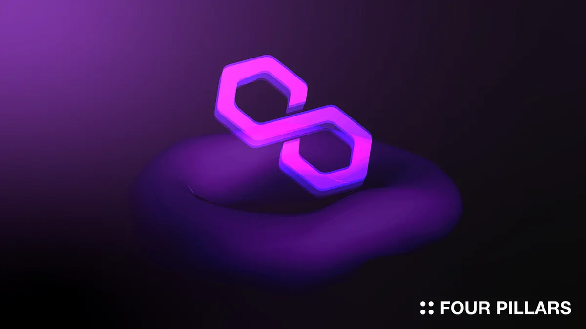
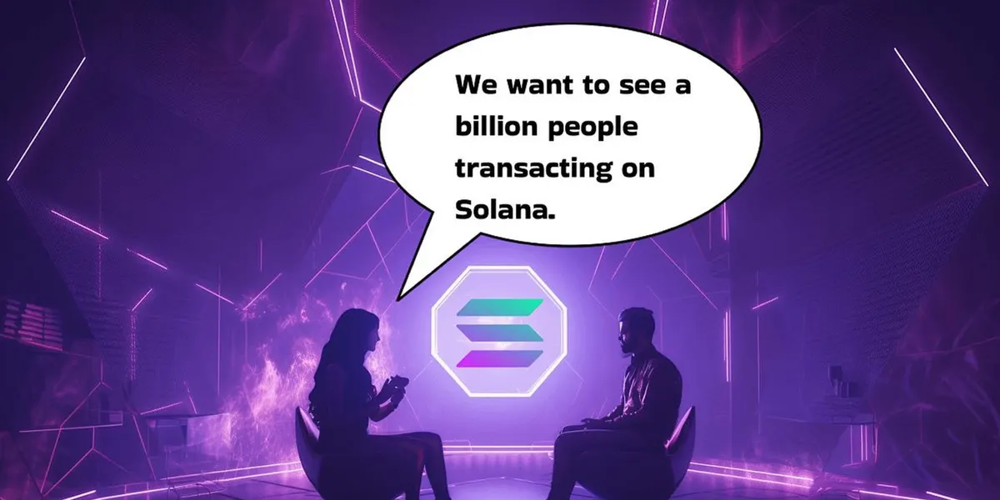
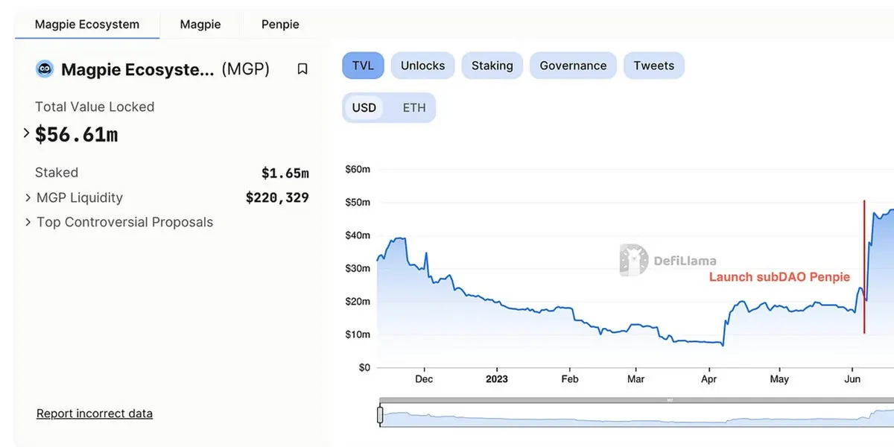
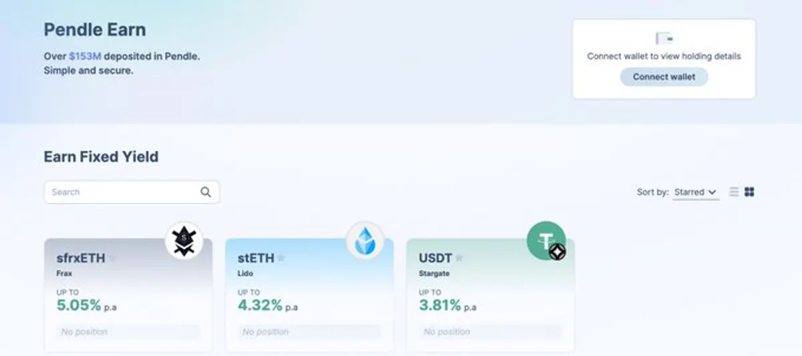

## 專案分析

- Chainlink 跨鏈互操作性協議 CCIP 上線主網，如何為跨鏈帶來安全性？
- 從解析 Lens V2 ：開放式操作和價值共享，能否改變社交的遊戲規則？
- 解讀 UniswapX ：將聚合交易去中心化，鏈上做市商的黃金時代來臨
- 深入 MakerDao 的過去和未來：長期價值被低估，更多利好即將到來

## 觀點剖析

- Polygon 2.0：大規模採用的新藍圖
- Solana DeFi 負責人：L2 時代對 Solana 的影響
- EthCC 2023上發布的 8 個重點專案：從基礎建設到應用，多點新方向

## 市場分析

- 別再迷失在「鏈」中，一步一步教你辨別各種鏈的差異！
- subDAO：Web3 專案的拓展新密碼
- CeFi 和 DeFi 賺幣收益來源大公開

---

## Chainlink 跨鏈互操作性協議 CCIP 上線主網，如何為跨鏈帶來安全性？

本文介紹了 Chainlink 的跨鏈互操作性協議（CCIP），並強調該協議在主網上的正式啟用。CCIP 是一個開源的去中心化跨鏈消息傳遞協議，其安全性是協議設計的核心。其中，CCIP 引入了安全功能，如 Active Risk Management（ARM）網路和跨鏈代幣傳輸的速率限制等，這些功能確保了協議的安全性和效率。

此外，CCIP 的隨插即用跨鏈功能使得跨鏈操作更加安全高效。已被許多機構採用與支持，未來將有助於消除跨鏈橋的風險，使用戶能夠體驗到更安全簡便的跨鏈交易。

[https://twitter.com/ChainLinkGod/status/1681118318567243776](https://twitter.com/ChainLinkGod/status/1681118318567243776)

## 解析 Lens V2 ：開放式操作和價值共享，能否改變社交的遊戲規則？

本文深入解析 Lens V2，這是目前加密世界中受矚目的社群網路應用，V2 版本相比 V1 多增加了可編程性和多種的操作功能。例如，用戶可以直接鑄造 NFT 或直接在 Uniswap 上交易等。

除了考慮到網路的效用性外，Lens V2 還推出了自己的 L3 網路 "Mamoka" 來提升效率並降低成本。V2 引入的集體價值共享概念將激勵創作者推出更多優質內容，並與收藏者之間進行更多的價值共享。Lens V2 的升級將帶領社群網路走向下一個新的篇章。

[https://www.techflowpost.com/article/detail\_12510.html](https://www.techflowpost.com/article/detail_12510.html)

## 解讀 UniswapX ：將聚合交易去中心化，鏈上做市商的黃金時代來臨

文章解讀了 UniswapX，這是由 Uniswap 推出的非託管、基於荷蘭式拍賣的聚合協議。UniswapX 引入了 fillers 角色，將路由複雜性外包給第三方 fillers，並讓他們競爭流動性的提供，使用戶能夠獲得更優惠的交易價格。

UniswapX 不僅提供更優惠的交易價格，還具有無需 ETH Gas 的交易、防止 MEV 攻擊、無交易失敗費用等特性。這些優勢使 UniswapX 與 Uniswap V4 的結合為專業做市商提供更大的空間，並大大改變了 DEX 的遊戲規則，未來有望與中心化交易所站在同一高度並與之競爭。

[https://www.techflowpost.com/article/detail\_12509.html](https://www.techflowpost.com/article/detail_12509.html)

## 深入 MakerDao 的過去和未來：長期價值被低估，更多利好即將到來

本文深入剖析 MakerDAO 的發展階段，包括 V1 和 V2 版本，以及在未來 V3 將要解決的問題。MakerDAO 在 V1 時期只能透過抵押 ETH 鑄造 SAI，而 V2 則增加了抵押物類型來鑄造 DAI，並取代 SAI 成為 MakerDAO 主要的穩定幣。

V2 在治理冷漠和缺少價值積累方面存在問題，未來 V3 將透過 subDAO 的模式提高不同業務的獨立營運效率與盈利，並進行代幣的拆分，改變穩定幣供應量減少的情況。MakerDAO 作為穩定幣賽道的龍頭，相信 V3 升級將讓更多人認識其堅強實力。

[https://www.techflowpost.com/article/detail\_12531.html](https://www.techflowpost.com/article/detail_12531.html)

## Polygon 2.0：大規模採用的新藍圖

本文主要探討區塊鏈網路在實現大規模採用方面所面臨的挑戰，並深入介紹 Polygon 2.0 在大規模採用上的機制和優勢。Polygon 2.0 引入了新代幣 POL，並提供充足的獎勵增長預算、新敘事的快速跟隨、資源共享提高效率等功能。Polygon 2.0 的更新將提供更優秀的用戶體驗，其可擴展性和互操作性也將促進大規模採用。

[https://medium.com/fourpillars/polygon-2-0-a-new-blueprint-for-mass-adoption-ede6b93bb799](https://medium.com/fourpillars/polygon-2-0-a-new-blueprint-for-mass-adoption-ede6b93bb799)

## Solana DeFi 負責人：L2 時代對 Solana 的影響

文章透過分析師 Ignas 和 Solana DeFi 負責人 Michelle 的對話，深入了解 Solana 相對於以太坊 L2 的優勢。Solana 在安全性、去中心化和可組合性方面表現出色，並可以發展出更統一的生態系統，彼此之間也能共享流動性。雖然受 FTX 事件影響後，Solana 的 TVL 下降，但推出的 EVM 兼容網路有望吸引生態系統的流動性，並因在 RWA 領域提供更好支持，帶來更多鏈上的價值與流動性。

[The Endgame for Solana: An AMA with Michelle, DeFi BD at Solana Foundation（Ignas | DeFi Research）](https://ignasdefi.substack.com/p/the-endgame-for-solana-an-ama-with)

## EthCC 2023上發布的 8 個重點專案：從基礎建設到應用，多點新方向

文章整理了 EthCC 2023 大會上 8 個重要的專案發展更新，特別關注 Lens、Uniswap 和 Chainlink 的新技術發展。熊市期間仍有許多專案持續開發，目標是提供更好的使用體驗和便利性，成為區塊鏈大規模採用的助力。

[https://www.techflowpost.com/article/detail\_12540.html](https://www.techflowpost.com/article/detail_12540.html)

## 別再迷失在「鏈」 中，一步步教你辨別各種鏈的差異！

文章針對各種與鏈相關的技術術語進行解說，解決區塊鏈最重要的兩個問題：互操作性和可擴展性。涵蓋了 Crosschain、Omnichain 和各種鏈技術，幫助讀者更好地理解相關文章內容。

[https://twitter.com/CryptoKoryo/status/1678399566092320768](https://twitter.com/CryptoKoryo/status/1678399566092320768)

## subDAO：Web3 專案的拓展新密碼

本文討論了 subDAO 的概念及其潛在好處。subDAO 提供了獨立的擴展能力，並且與 ParentDAO 之間存在互利共贏的關係。透過 subDAO，Web3 專案能夠快速獲得發展預算，並加速整個專案的生態擴展。

[subDAO，web3 项目的扩张新密码（CapitalismLab）](https://capitalismlab.substack.com/p/subdaoweb3)

## CeFi 和 DeFi 賺幣收益來源大公開

推文中作者針對 CeFi 和 DeFi 的賺幣收益來源以及推出的目的為何進行說明。CeFi 賺幣產品的收益分別來自利用槓桿池出借資金賺取槓桿交易用戶利息，以及透過衍生品策略組合來提供收益，並簡化包裝它們；而 DeFi 主要採用借貸和質押模式來讓用戶賺取利息，不論是 CeFi 或 DeFi，它們的目的都是希望能吸引用戶並增加用戶黏著度。

最後作者也提到 Pendle Earn 也是透過把複雜的收益機制包裝成簡單好理解的方式來吸引用戶，許多 DeFi 背後的運作機制的複雜度反而成為用戶的進入門檻，簡單化、友好化將是用戶成長的重要關鍵。

[https://twitter.com/althunter31/status/1681536997658345472](https://twitter.com/althunter31/status/1681536997658345472)

### **結尾**

感謝您閱讀本篇文章，希望本文的內容能夠對您有所啟發和幫助。

> 如果您對區塊鏈出圈科普知識感興趣，請搜索 🔍 **[WalkinCat 走路貓](https://portaly.cc/walkincat)**，了解更多相關資訊。如果您想繼續關注我們的最新文章，歡迎訂閱我們的電子報，或透過以下連結找到我們。我們期待您的想法和反饋，謝謝您的支持！
