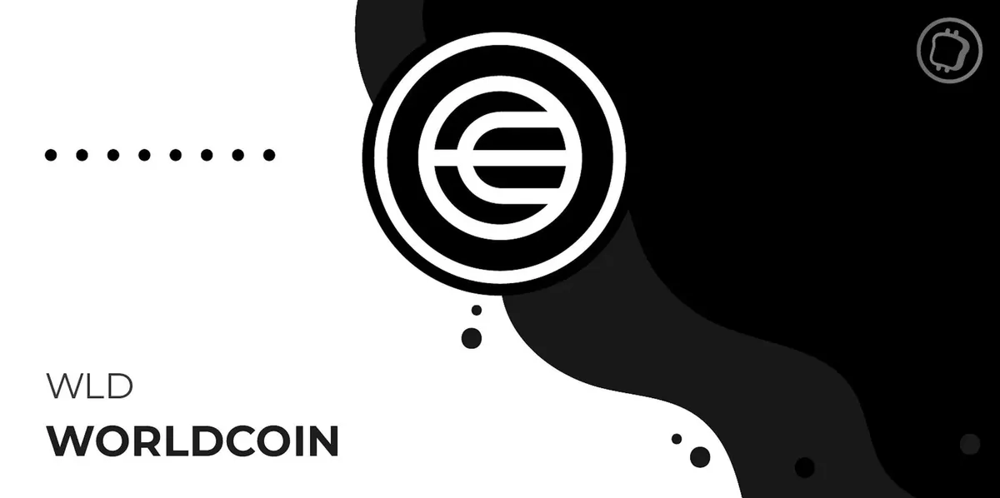
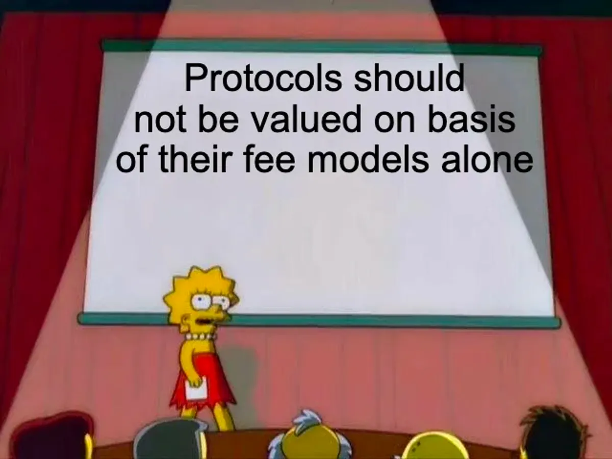
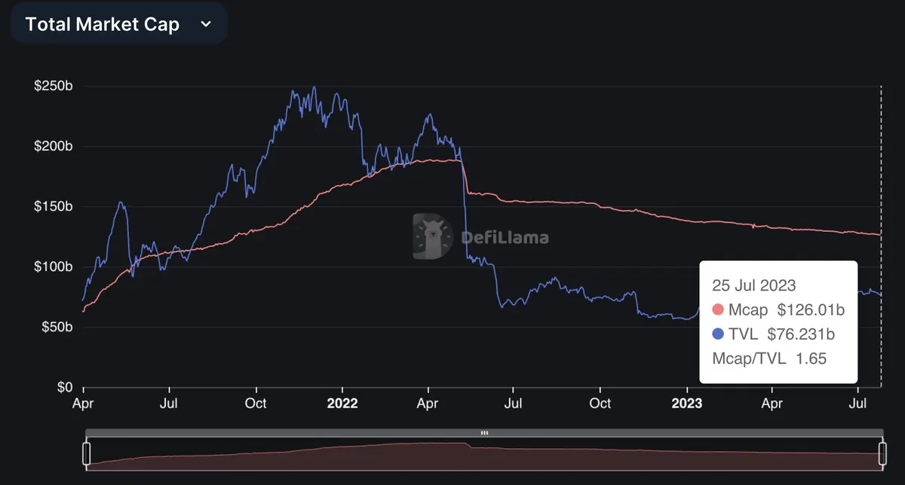
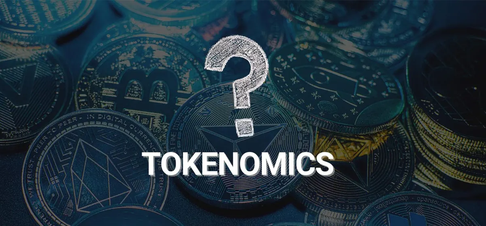
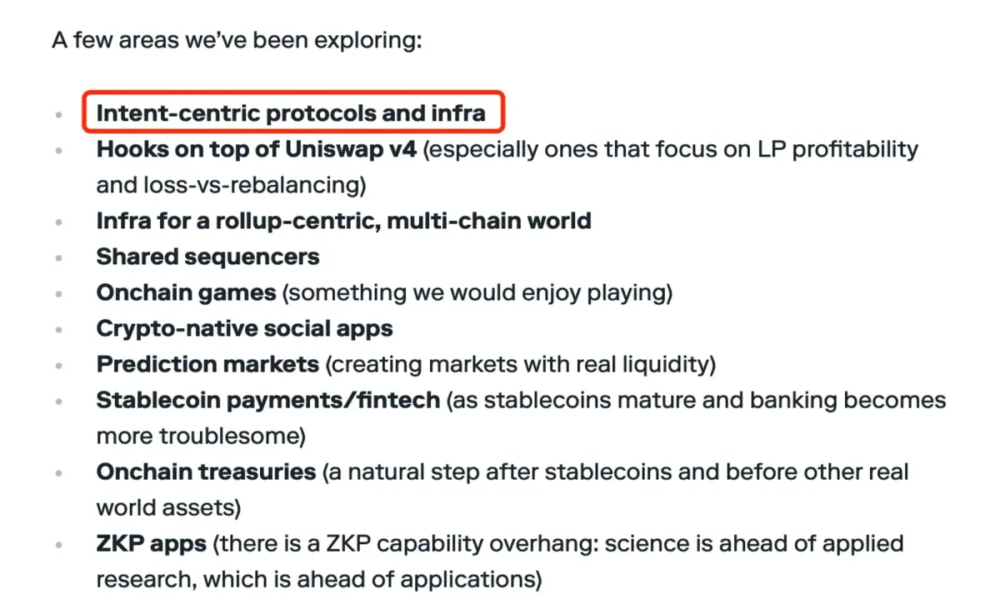
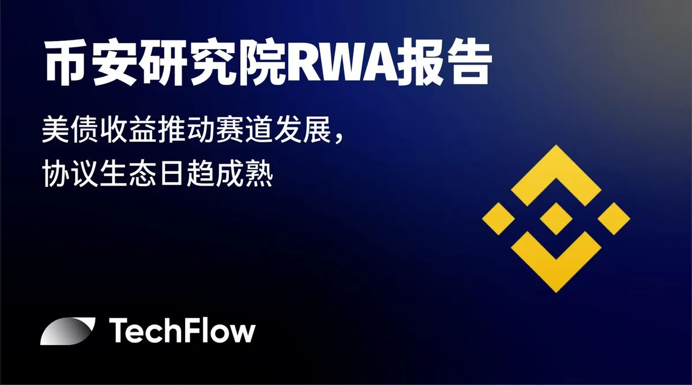
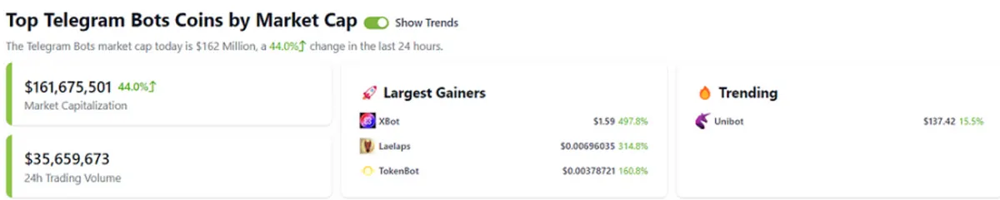
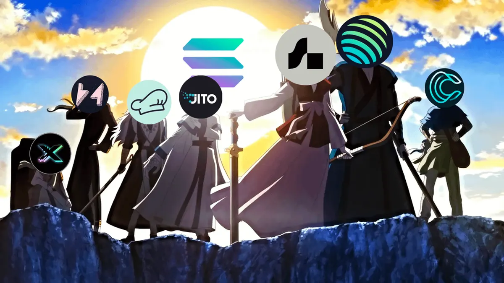
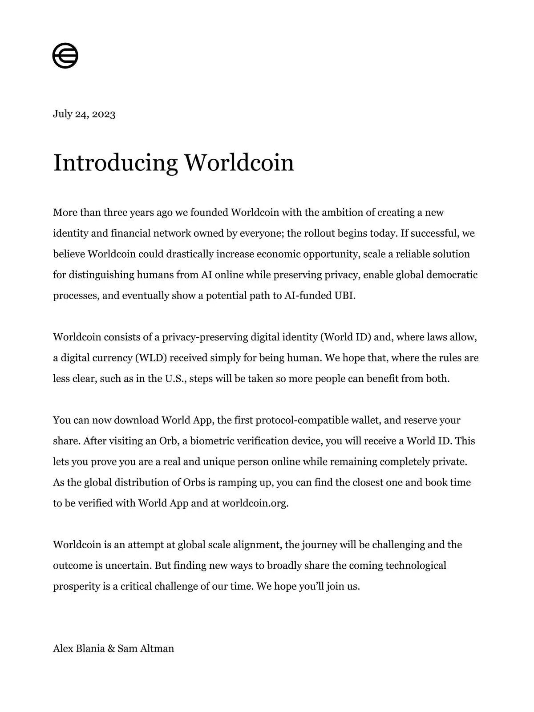

## 專案分析

- Vitalik：對 Worldcoin 和生物身份證明的看法

## 觀點剖析

- Web3 協議層價值探討：從經濟模型中賺錢，或是低成本服務社群？
- 進入去中心化穩定幣的黃金時代：有哪些新變革？
- 共識與非共識：熊市中的逆週期方向
- 代幣經濟學 101：如何創造和累積真正的價值？

## 市場分析

- Paradigm 提出十大潛在趨勢，排在第一的 “intent-centric” 是什麼？
- 解讀幣安研究院 RWA 報告：美債收益推動賽道發展，協議生態日趨成熟
- 了解 Telegram Bot 賽道面臨的機遇和風險
- Solana DeFi 2.0？ 盤點值得關注的生態項目

## 熱門事件

- Worldcoin 代幣正式上線，將分發給全球超過 200 萬人

---

### Vitalik：對 Worldcoin 和生物身份證明的看法

Vitalik 在其最新文章中討論了 Worldcoin 如何透過建立身分證明系統和 UBI 機制來填補 AI 對人類的影響，以及生物識別的驗證方式會為人類帶來哪些風險，並探討這樣的方式是否合適，又或是有哪些替代方案。

Vitalik 透過分析生物識別的身份證明系統在隱私、可訪問性、中心化和安全這四個主要的挑戰上，來說明可能的解決方式，並探討基於社交圖譜的身份驗證替代方案中的優缺點。

最後文中也比較了社交圖譜、通用硬體和專業硬體的驗證方式，Vitalik 認為若把這些驗證方式結合起來將能達到互補作用。雖然現行的驗證方式都有其風險，不過沒有人類身份證明的世界也有風險，因此他也期望未來在身分驗證領域上能夠有更多的進展，以解決當前所面臨的問題。

[https://www.techflowpost.com/article/detail\_12565.html](https://www.techflowpost.com/article/detail_12565.html)

## Web3 協議層價值探討：從經濟模型中賺錢，或是低成本服務社群？

本文作者深入探討 Web3 中協議和應用程式價值的獲取差異，並重新審視 “Fat Protocol Thesis” 理論的正確性，這個理論主張協議的價值會高於建立在其上的所有應用程式價值總和。

文中從圖表中我們可以得知，以太坊上成熟的應用程式是可以產生比新型網路上整個協議更多的費用，因此作者認為 “Fat Protocol Thesis“ 並不完全正確。

最後作者引用了亞馬遜的例子說明，若區塊鏈是交易的基礎設施，將會是以低成本或是固定成本下去做協議層的價值設計，而非以營利為主要設計。藉由文章中對於協議與應用的價值探討，將有助於我們釐清它們的本質與真實價值。

[https://foresightnews.pro/article/detail/38411](https://foresightnews.pro/article/detail/38411)

## 進入去中心化穩定幣的黃金時代：有哪些新變革？

本文主要針對去中心化穩定幣的現狀和未來潛力進行深入探討。文中展示了非營利組織 Bluechip 對頂級穩定幣的安全評級結果，其中 BUSD、PAXG、GUSD 和 LUSD 獲得最高評級。

文中作者也針對 Lybra、Liquity V2、Synthetix V3、MakerDAO、Frax V3、GHO 和 crvUSD 這些穩定幣協議分別進行詳細的說明與分析。

穩定幣市場過去雖然經歷了 UST 崩盤和 USDC 的脫鉤事件，不過也因為這些事件，許多去中心化穩定幣能夠正確的調整他們的方向，讓整個去中心化的穩定幣生態更加健康，並持續向真正的黃金時代一步步邁進。

[Entering a Golden Age of Decentralized Stablecoins: What's New?（Ignas | DeFi Research）](https://www.ignasdefi.com/p/entering-a-golden-age-of-decentralized)

## 共識與非共識：熊市中的逆週期方向

本文作者針對加密產業存有的三個市場觀點：共識、非共識、思考，進一步說明他的見解。在普遍共識下目前市場有兩種主要的投資策略，一個是與金融相關的機會，如保險、支付通道和穩定幣；另一個則是應用層。

在非共識觀點上，作者討論了加密行業投資邏輯的轉變、L2 與高性能 L1 之間的競爭，以及人工智能和 Web3 的潛在整合。

最後作者除了點出當前行業面臨的問題，也提到當產業中現有解決方案不足時，應該跳脫出原本的框架，並將思考轉換到更高的視角來尋求其他的市場機會。

[https://foresightnews.pro/article/detail/38751](https://foresightnews.pro/article/detail/38751)

## 代幣經濟學 101：如何創造和累積真正的價值？

本文主要說明代幣價值積累的重要性，並介紹了四種創造代幣價值的途徑，分別是：實用性、生產性資產、價值儲存資產和治理權。L1 的原生代幣在保障網路安全方面扮演著重要的角色，因此具有實用性；而協議和應用程式相關的代幣則需要明確定義其用途才能獲得價值。此外，協議如何創造價值、如何捕獲價值以及價值如何分配，對於生產性資產的定義至關重要。

目前，大多數代幣的價值來源主要是實用性和生產性，不過未來除了 L1 之外，其他協議的實用性可能會隨著監管的加強而逐漸消失，並將朝著生產性的途徑來獲取代幣價值。

> 因此協議的品質、市場需求規模和網路效應將成為重要的價值來源依據。

[https://www.techflowpost.com/article/detail\_12569.html](https://www.techflowpost.com/article/detail_12569.html)

## Paradigm 提出十大潛在趨勢，排在第一的 “intent-centric” 是什麼？

Paradigm 在其重點關注的十大加密領域潛力趨勢中，將「意圖」的相關協議和基礎設施列為第一，文中作者引用 ETHGlobal Paris 入圍決賽的專案來向大家說明何謂意圖。

意圖可以想像成是用戶最終希望得到的結果，中間交易過程的細節並不要求，因此協議可以依據這個意圖來幫客戶設計出最適合的交易流程。

未來用戶只需要發起他們希望得到的意圖，協議就能自動幫他執行，這樣的方式也能大幅地降低用戶對於區塊鏈交易過程的理解程度。結果論或許會是真正打中用戶心中的最佳解方，並讓大規模採用不再被技術理解的高牆所阻礙。

[https://panewslab.com/zh/articledetails/ls1d0j1x.html](https://panewslab.com/zh/articledetails/ls1d0j1x.html)

## 解讀幣安研究院 RWA 報告：美債收益推動賽道發展，協議生態日趨成熟

幣安於近日發布關於 RWA 的市場情況報告，該報告分析了目前 RWA 市場的發展現況、生態系統和主要參與方，以及對未來的發展預測。

文中除了說明 RWA 的代幣化過程，以及當前市場的 RWA 產品領域，也介紹了幾個 RWA 領域發展的專案，包括 MakerDAO、Compound、Aave 等協議，以及 Franklin Templeton、Ondo Finance、Matrixdock 等公司。

美債的收益讓許多人看見 RWA 的潛力，報告也預測未來將會有更多機構參與 RWA 市場，為 RWA 提供更多的用例與機會，並成為推動加密產業發展的一大動力。

[https://www.techflowpost.com/article/detail\_12588.html](https://www.techflowpost.com/article/detail_12588.html)

## 了解 Telegram Bot 賽道面臨的機遇和風險

近期 Telegram Bot 賽道獲得加密市場的大量關注，除了因為 Telegram 擁有龐大的用戶基數，它們還能夠滿足用戶在 Telegram 上一條龍式的互動體驗，這些服務包括交易、空投、社區、跨鏈等場景。

作者簡述了這些 Telegram Bot 的類型和功用，並分析了這個賽道在市場的機會和可能的風險。在加密市場中，投資機會的執行速度差異將會極大地影響獲利能力。因此，一站式的資訊獲取和交易能夠有效地縮短認知到執行的時間差，這必然會成為這個賽道最具吸引力的地方。

[https://foresightnews.pro/article/detail/38663](https://foresightnews.pro/article/detail/38663)

## Solana DeFi 2.0？ 盤點值得關注的生態項目

過去 Solana 因為 FTX 事件以及網路不穩定的因素，生態受到嚴重影響，不過最近 Solana 也公佈了許多技術更新，可以看出整個生態已經開始逐漸復甦，作者在文中介紹了 6 個他認為有潛力並值得探索的新協議：

1. JitoSOL：流動性質押協議代幣，透過 MEV 增強來提高 SOL 質押年化收益
2. Marinade：流動性質押協議，存入 SOL 換取 mSOL，並利用 mSOL 至其他協議賺取額外收益
3. MarginFI：借貸平台，採用積分系統來計算借貸行為
4. JupiterExchange：交易協議，採用跨多路由方式，並可設置限價訂單以及 DCA 機制
5. Cypher：交易借貸平台，採用積分系統計算平台上永續交易、現貨交易及借貸行為

在浩劫重生後，Solana 展現了其強韌的生命力和決心，期待它能為加密產業帶來新的風貌。

[https://www.techflowpost.com/article/detail\_12591.html](https://www.techflowpost.com/article/detail_12591.html)

## Worldcoin 代幣正式上線，將分發給全球超過 200 萬人

Worldcoin 近日宣布正式上線其代幣 WLD，並將會把代幣分發給全世界 超過 200 萬的測試用戶，經過 Orb (生物驗證設備) 驗證過的人會先得到 25 個 WLD 的空投。 Worldcoin 為了應對 AI 對人類的衝擊，並且落實全民基本收入（UBI）的理念，因此計劃透過分發免費的 WLD 代幣來實現財富的公平分配。

雖然有些人認爲透過掃描虹膜的方式在隱私上會有很大的疑慮，不過 OpenAI 創始人確實帶領著人類在科技以及金融領域持續邁進，並試著建立人們理想中的烏托邦願景。

[https://www.panewslab.com/zh/sqarticledetails/1imu6uyz.html](https://www.panewslab.com/zh/sqarticledetails/1imu6uyz.html)

---

### **結尾**

感謝您閱讀本篇文章，希望本文的內容能夠對您有所啟發和幫助。

> 如果您對區塊鏈出圈科普知識感興趣，請搜索 🔍 **[WalkinCat 走路貓](https://portaly.cc/walkincat)**，了解更多相關資訊。如果您想繼續關注我們的最新文章，歡迎訂閱我們的電子報，或透過以下連結找到我們。我們期待您的想法和反饋，謝謝您的支持！
