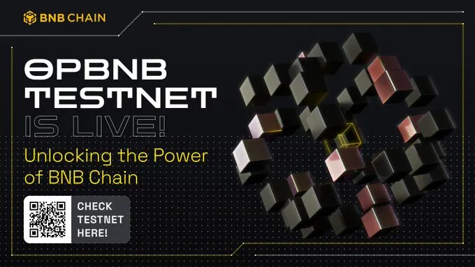
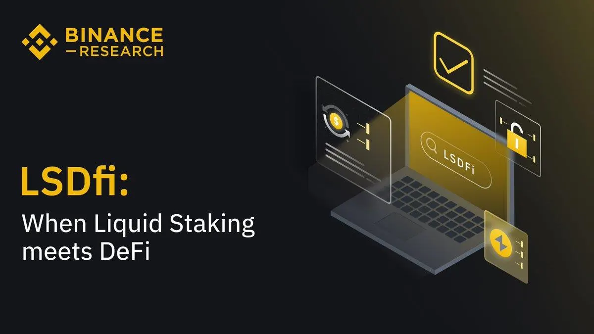
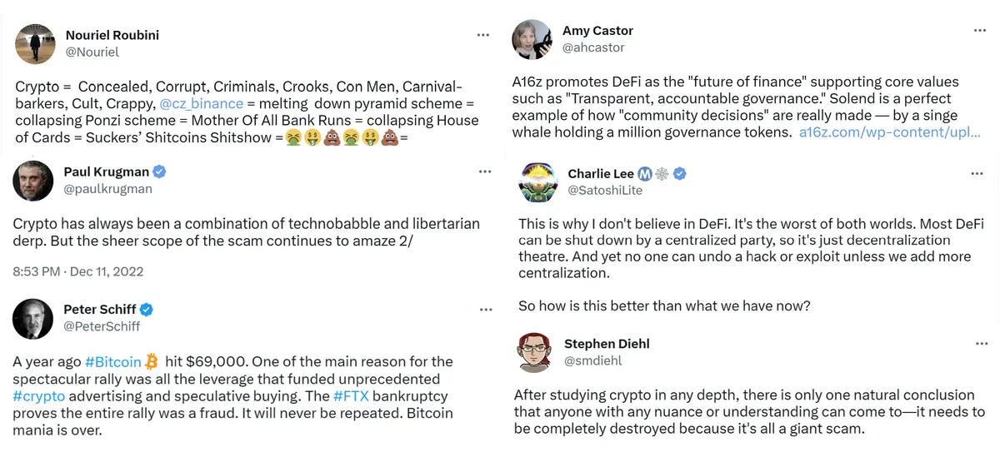
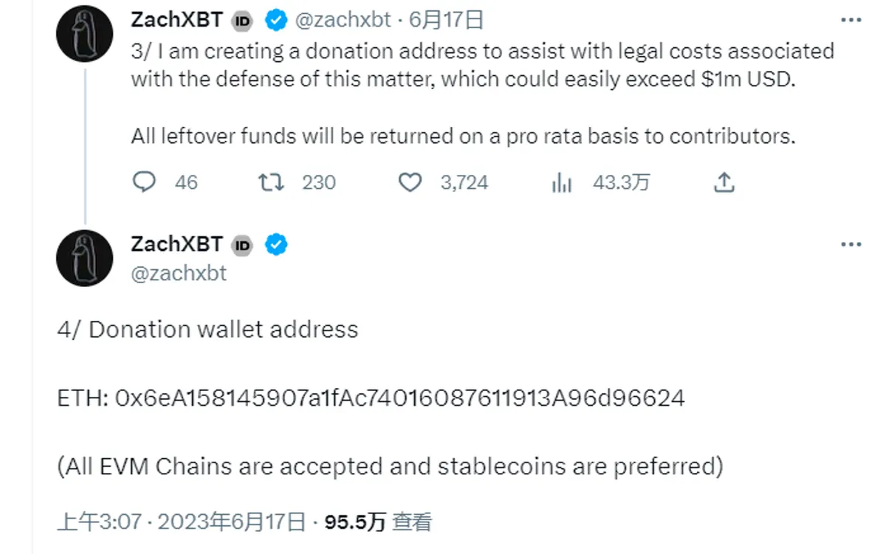

## 專案分析

- 幣安推出 OpBNB，L2 時代的 BNB Chain 體系將何去何從？
- 背靠華爾街財團，加密交易平台 EDX Markets 究竟是何方神聖？
- Arbitrum 率先進入 Layer3 時代，Orbit 的創新與隱患

## 觀點剖析

- 以太坊模塊化的第一步：Proto-danksharding 基本介紹及其工作原理
- 解讀幣安研究院 LSDfi 報告：當流動性質押與 DeFi 相遇
- 以加密貨幣的騙局爭議：了解加密貨幣批評者的論點
- 加密貨幣和 AI 的融合：四個關鍵的交集點

## 市場分析

- AC Capital：RWA 鏈上借貸項目比較分析
- 鏈上數據解析 LSDfi 市場格局：誰將贏得 LSDfi 戰爭？

## 熱門事件

- 鏈上偵探 ZachXBT 被 “麻吉大哥” 起訴，獲得社區超過百萬美元捐款
- 內文

## 幣安推出 OpBNB，L2 時代的 BNB Chain 體系將何去何從？

opBNB 是基於 OP Stack 開發的 BSC L2，在容量和速度上都優於當前的 ETH L2，透過在 OP Stack 上引入優化，使其可以達到 4000+ TPS 的容量和 1 秒的出塊時間，且轉帳交易費用能夠低於 0.005美元，不過這些優化主要受益於原先 BSC 相對於 ETH 就有的優勢。

然而，資產安全性和生態建設是目前 opBNB 需要面對的主要挑戰，opBNB 從 BSC 上橋接來的資產多半為非原生資產，需依賴 CEX 的安全性，不過幣安後續可能會針對這個問題來解決。在生態建設上，幣安前陣子推出的 BNB Greenfield 也將會作為其數據採用層以達到一整套的內循環體系。對於 OP 而言，opBNB 的出現並不會直接帶來好處，但隨著未來 SuperChain 的敘事到來，可能會逐漸對市場產生一定的影響。

[https://twitter.com/NintendoDoomed/status/1671383150382170113](https://twitter.com/NintendoDoomed/status/1671383150382170113)

## 背靠華爾街財團，加密交易平台 EDX Markets 究竟是何方神聖？

EDX Markets 是由 Citadel Securities、富達投資和嘉信理財等華爾街力量支持的非託管加密貨幣交易平台，EDX 並不持有客戶的數字資產，主要是促進買賣訂單的匹配。透過把託管和做市這兩大要素分離來將傳統的金融市場架構複製到加密世界，更能夠符合 SEC 對交易平台審視的標準。

EDX Markets 專為機構投資者服務，並提供 BTC、ETH、LTC 和 BCH 四種加密貨幣的交易，目前這些資產並未被美國 SEC 認定為證券，該交易所也計劃後續將推出清算機構 EDX Clearing 來進行 EDX Markets 平台的交易結算。

在 SEC 強力打壓 Binance 和 Coinbase 等加密貨幣平台之時，EDX Markets 的出現不免讓人對於 SEC 與華爾街之間的關係有其他遐想，不過這樣的交易平台出現可以看出加密貨幣市場依舊十分誘人，讓越來越多傳統金融機構也紛紛搶著進場。

[https://www.techflowpost.com/article/detail\_12253.html](https://www.techflowpost.com/article/detail_12253.html)

## Arbitrum 率先進入 Layer3 時代，Orbit 的創新與隱患

作者在推文中討論了近期 Arbitrum 低調上線的 Arbitrum Orbit，並分析其與 OP stack 的差異性。Arbitrum Orbit 是基於 Arbitrum Rollup 的擴容性解決方案，開發者可以基於 Arbitrum Nitro Stack 開發定制的 L3，並在共識機制、治理模式、gas fee 代幣的選擇及經濟模型上高度自治，讓開發者可以有更多的靈活性和自主性。

不過作者認為這樣的進程與 OP stack 相比過於超前，這種超前於應用發展的技術革新對反而會揠苗助長，由市場和應用所驅動的迭代發展模式或許會更有助於生態的形成。

[https://panewslab.com/zh/articledetails/qy49b71e.html](https://panewslab.com/zh/articledetails/qy49b71e.html)

## 以太坊模塊化的第一步：Proto-danksharding 基本介紹及其工作原理

推本文針對後續升級將引入的以太坊改進提案 EIP-4844 進行說明與討論，EIP-4844 也稱為「原生資料庫」，旨在改善建立在以太坊的 Rollup 可擴展性。EIP-4844 將會有新的交易類型，透過將 blob 交易與常規交易分開，降低了從 Rollup 將數據發布到以太坊的成本。

文章中提到了以太坊開發人員在減輕中心化趨勢和提高抗審查能力方面所面臨的挑戰，也討論 Rollup 和其他 Layer1 區塊鏈之間的競爭，以及需要信任最小化的證明系統來消除對多重簽名錢包的依賴。

EIP-4844 的引入將有利於 Rollup 協議和運營商，而 Rollup 協議的收入增加也將為協議和用戶帶來新的機會，未來坎昆升級後除了是以太坊模塊化的一小步，也將是整個以太坊生態擴展的一大步。

[https://panewslab.com/zh/articledetails/542e7ii0.html](https://panewslab.com/zh/articledetails/542e7ii0.html)

## 解讀幣安研究院 LSDfi 報告：當流動性質押與 DeFi 相遇

幣安研究院發布了一份 LSDfi 的研究報告，該報告總結了 LSDfi 的發展情況及風險描述。LSDfi 協議為 LSD 持有人提供的新機會，除了讓資產效率最大化，也實現資產的額外收益。報告中整理了目前 LSDfi 領域主要的協議類型，包括 DeFi 流動質押提供商、CEX 流動質押提供商、CDP 穩定幣、指數 LSDs、收益策略和貨幣市場這幾種類型。

雖然 LSDfi 的增長快速，但其總鎖倉規模還不到整個 LSD 市場的 3%，後續仍有很大的成長空間。不過報告中也提醒， LSDfi 擁有很大的潛力與機會，但投資者仍須了解到風險的存在，在新的機會中謹慎行事，才能夠放心擁抱市場帶來的甜美果實。

[https://www.techflowpost.com/article/detail\_12212.html](https://www.techflowpost.com/article/detail_12212.html)

## 加密貨幣的騙局爭議：了解加密貨幣批評者的論點

R本文整理了加密貨幣批評者看待加密貨幣的觀點，並針對幾個面向提出具體的見解。比特幣從原本成為全球貨幣的願景，到現在反而呈現高度籌碼集中以及能源消耗的問題，無非是一場失敗的實驗，而以太坊的 ICO 狂熱、NFT 的高投機性、DeFi 的非真正去中心化以及容易受到金融動盪影響等因素，也讓他們無法認同加密貨幣的存在。

此外，批評者認為加密貨幣的文化也常常被視為狂熱與邪教，不過這些批評也讓我們能夠了解到目前加密貨幣的實際處境，以及思考如何一步步改進這些弊端，才能夠真正讓加密貨幣的技術和應用獲得更多的認可。

[Is Crypto a Scam? Here's Why These Crypto Critics think It Is.（Ignas | DeFi Research）](https://ignasdefi.substack.com/p/is-crypto-a-scam-heres-why-these)

## 加密貨幣和 AI 的融合：四個關鍵的交集點

本文探討了加密貨幣和 AI 在技術發展中可能會有的四個重要交集：

1. GPU 的 AirBnB 模型：透過出租個人或組織閒置的 GPU 運算能力來滿足 AI 研究與開發者的需求，但須考慮顯卡資源和 AI 負載的匹配性、分散式 GPU 的高延遲處理及驗證問題。
2. 代幣激勵的人類反饋強化學習（RLHF）：藉由代幣激勵的方式促使更多人參與到 RLHF 中，不過 RLHF 應用在不同領域需有不同的代幣激勵配套與機制。
3. 零知識機器學習（zkML）：採用零知識機器學習算法使在鏈上運算的工作變得更加簡單並可大幅降低鏈上成本。
4. 防止深度偽造的認證：藉由公鑰加密系統讓創作者使用其公共密鑰來簽署內容以證明真實性，並搭配公共記錄將公鑰映射到現實世界中的身份，從而實現驗證與建立信任。

目前加密貨幣和 AI 技術正在持續發展，未來若能將這兩大領域進行結合，將能夠為科技與社會進步帶來加成的效果，並帶來新的科技奇異點，因此持續關注這兩大領域的發展將能夠更好地了解下一個科技紀元的全貌。

[https://multicoin.capital/2023/06/02/the-convergence-of-crypto-and-ai-four-key-intersections/](https://multicoin.capital/2023/06/02/the-convergence-of-crypto-and-ai-four-key-intersections/)

## AC Capital：RWA 鏈上借貸項目比較分析

本文討論如何將加密生態系統與傳統金融進行整合，並讓現實世界的資產信用擴展至區塊鏈上。透過將區塊鏈技術創建現實資產的數字化，並將其作為抵押品以證明其在區塊鏈上的信用能力，藉由這樣的方式可以提供更具包容性、可負擔性和多元性的貸款服務，也讓貸方和借方能夠達到互利互惠的關係。

文章中除了分析幾個借貸專案創新的商業模式以及這個領域所面臨的挑戰，還提供了有關傳統債券市場歷史和規模的見解。透過文中的解析可以了解到鏈上與鏈下的結合展現了這種新興信貸服務的潛力，也為借貸市場打開新的服務管道，近期市場開始越多人關注到 RWA 的市場機會，或許這有可能會是下一次牛市的敘事之一。

- [https://mp.weixin.qq.com/s/q0k3cKjHMU-w1KuM1II5rg](https://mp.weixin.qq.com/s/q0k3cKjHMU-w1KuM1II5rg)

## 鏈上數據解析 LSDfi 市場格局：誰將贏得 LSDfi 戰爭？

DeFi 分析師 DeFi Mochi 透過鏈上數據分析了目前 LSDfi 市場的近況，從數據中可以看出雖然 Lybra Finance 近期因幣價下跌而導致 TVL 流失，但其仍然是 LSDfi 市場的龍頭。

鏈上數據顯示 crvUSD、Maverick protocol 及 Pendle 的 TVL 在持續的增長中，而過去一週 Gravita Protocol、unsheth、Lybra 則因為空投不確定性、遭受攻擊以及幣價下跌等因素正流失其 TVL。

作者認為可以藉由參與 Swell Network 的收益挖礦，以及 Gravita 和 Raft 的空投預期來押注 LSDfi 領域。LSDfi 仍在野蠻成長中，未來誰能真正稱霸這個市場還有待後續協議的發展狀況。

[https://twitter.com/defi\_mochi/status/1670808809890271232](https://twitter.com/defi_mochi/status/1670808809890271232)

## 鏈上偵探 ZachXBT 被「麻吉大哥」起訴 獲得社區超過百萬美元捐款

ZachXBT 是區塊鏈領域中有名的鏈上偵探，藉由分析鏈上數據踢爆許多詐騙的加密專案，而最近他因為揭露黃立成過去許多專案涉及割韭菜行為被黃立成提起誹謗訴訟。ZackXBT 發起社區捐款活動來籌集應對官司的資金，1 天內就從社區中獲得多個加密從業者和其他支持者超過 100 萬美元的捐款，其中也包括 Binance 首席執行官趙長鵬（CZ）的捐贈。

透過 Web3 社區大力支持「加密正義使者」的行動可以看出許多 Web3 參與者仍有對抗資本打壓的底層精神，也讓大家認知到，在區塊鏈世界的不法事蹟終究會留下證據，這也是為什麼 Web3 的信念始終受人推從的原因之一。

[https://panewslab.com/zh/articledetails/00bvnh1e.html](https://panewslab.com/zh/articledetails/00bvnh1e.html)

## 結尾

感謝您閱讀本篇文章，希望本文的內容能夠對您有所啟發和幫助。

如果您對區塊鏈出圈科普知識感興趣，請搜索 🔍 **[WalkinCat 走路貓](https://portaly.cc/walkincat)**，了解更多相關資訊。如果您想繼續關注我們的最新文章，歡迎訂閱我們的電子報，或透過以下連結找到我們。我們期待您的想法和反饋，謝謝您的支持！
