許多人因為對於 BRC-20 的原理及玩法無法快速理解，又或者是因為高昂的鏈上 Gas 費望之卻步，於是在這波的 BRC-20 迷因浪潮中完美錯過。在這篇教程中我們將教會你如何快速鑄造 LTC20 代幣，讓你抓住有可能從 BRC 風潮中外溢的暴富新機會。

### 準備工作

> LTC 錢包安裝

1. 安裝 LTC 錢包的應用程式，可從下方網址下載：

- https://atomicwallet.io/

2. 安裝完成後，請務必將錢包助記詞備份下來，並設置好錢包密碼。
   
   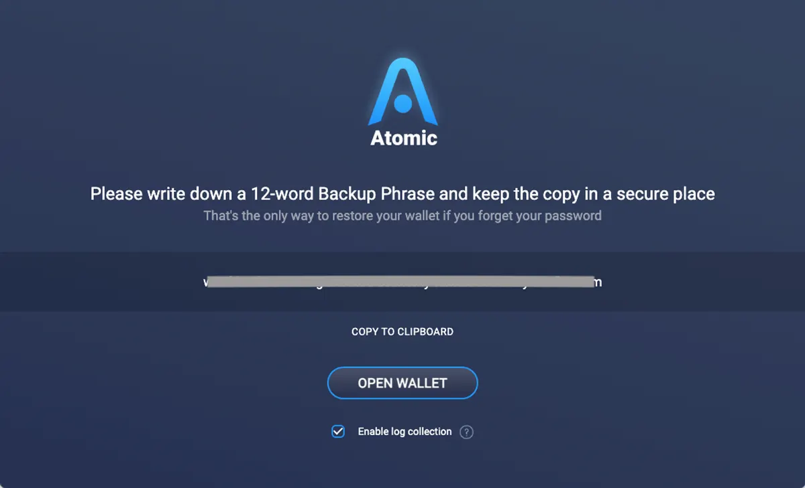
   
3. 點擊畫面左邊的 Wallet，然後選擇 Litecoin。
   
   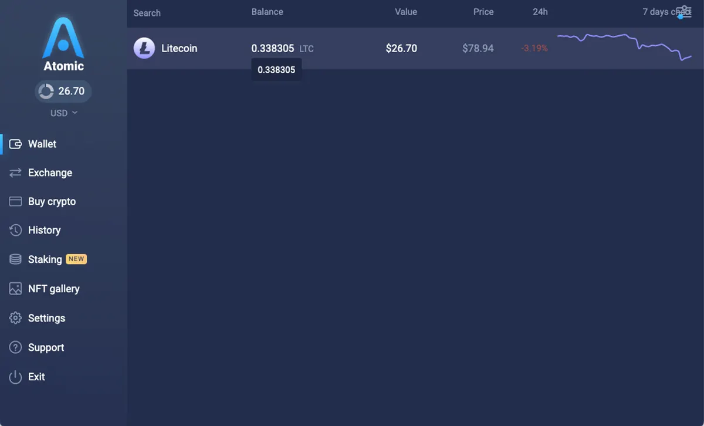
   
4. 點擊 “RECEIVE” 按鈕，出現的地址就是 LTC 的錢包地址，先將你的 LTC 地址複製起來。
   
   （可先從交易所將 LTC 提款至這個地址，以便後續的操作花費使用）
   
   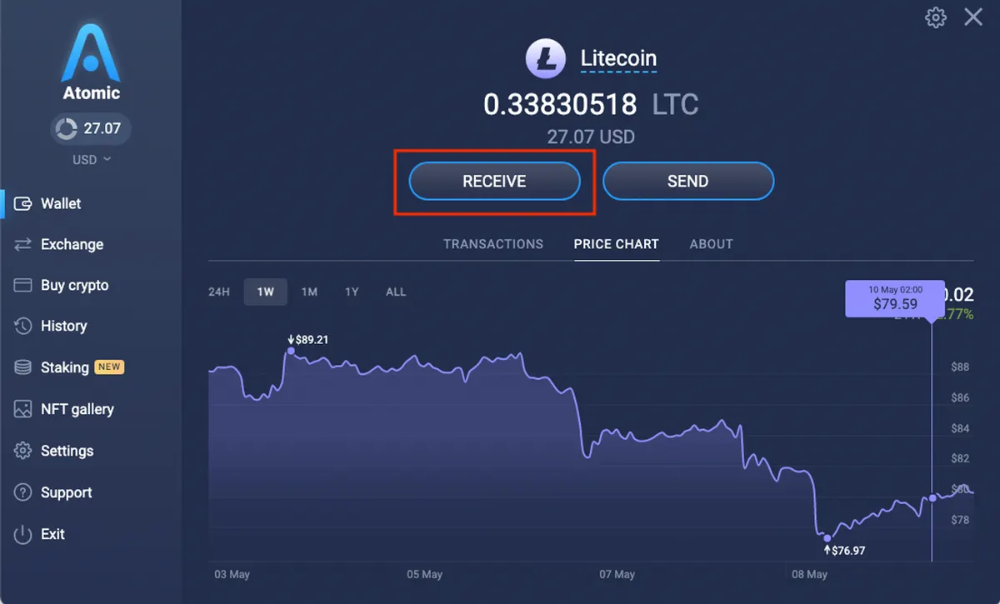
   
   > **鑄造流程**
   

現在，讓我們開始鑄造 LTC-20 代幣吧！

1. 進入這個網站：
   
   **[https://litescribe.io/ltc20](https://litescribe.io/ltc20)**
   
2. 可以先查看首頁列表中代幣的鑄造情況，Progress 欄位的進度條顯示 100% 代表該代幣名稱已被鑄造完

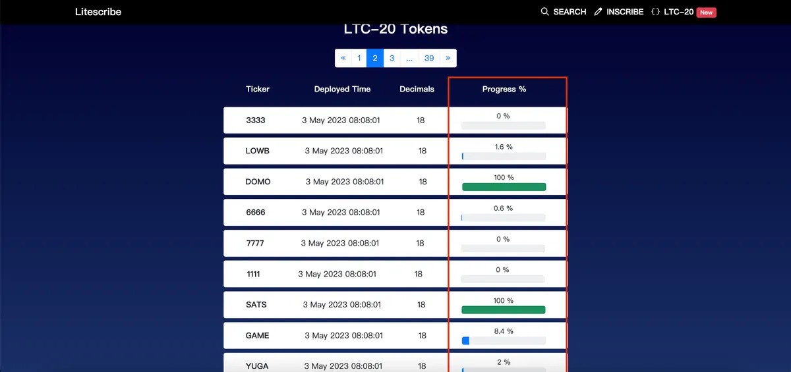

3. 點擊右上角的 “ INSCRIBE” 進入鑄造頁面
   
   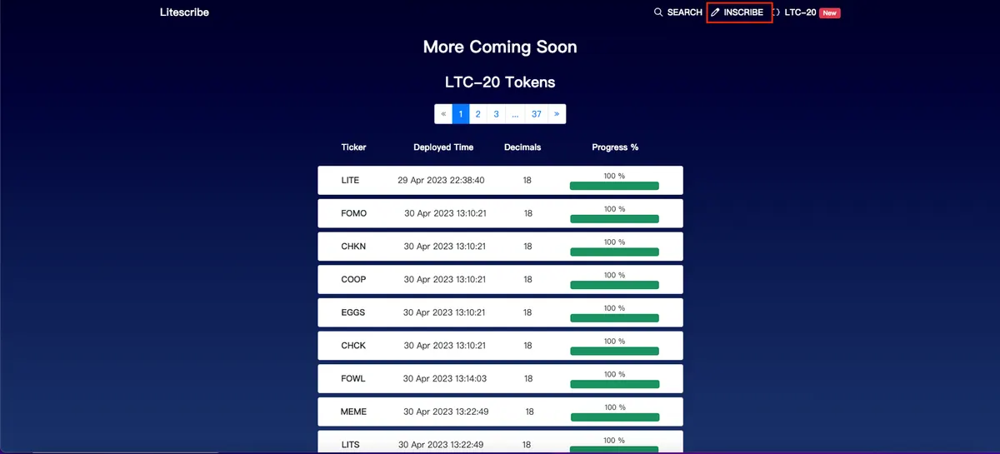
   
4. 接著點選 “ltc-20”

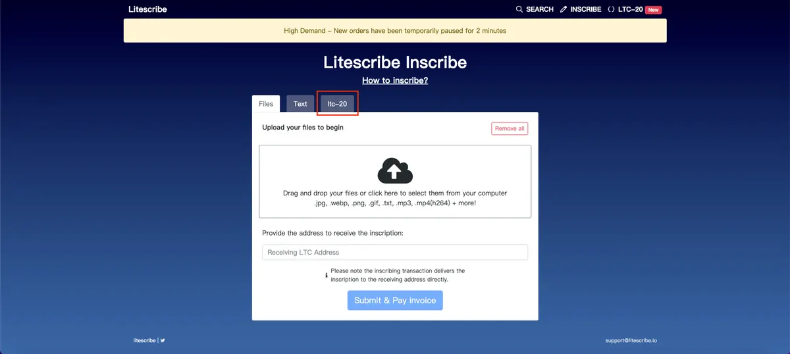

5. 畫面上方選項選擇 “mint”，Tick 欄輸入要鑄造的代幣名稱，若輸入完顯示打勾代表可以鑄造。接著點選要鑄造的數量，完成後點擊 “Upload”
   
   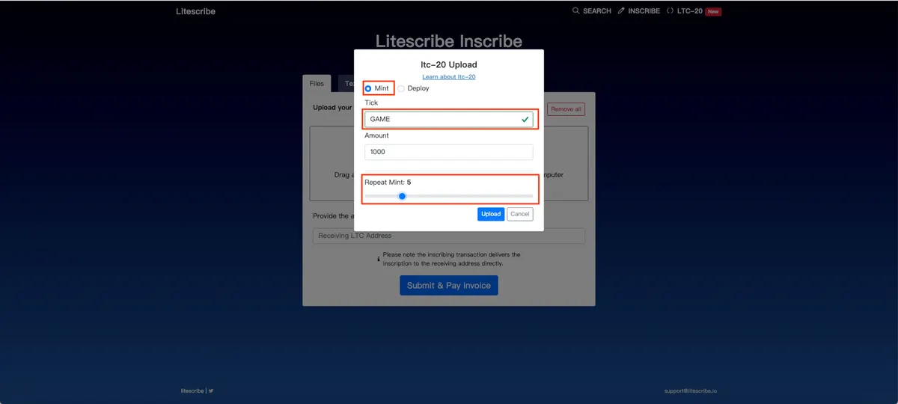
   
6. 貼上剛才複製的 LTC 錢包地址，表示是用這個地址來接收鑄造的 LTC20 代幣，輸入完後點選下方 “Submit & Pay invoice”
   
   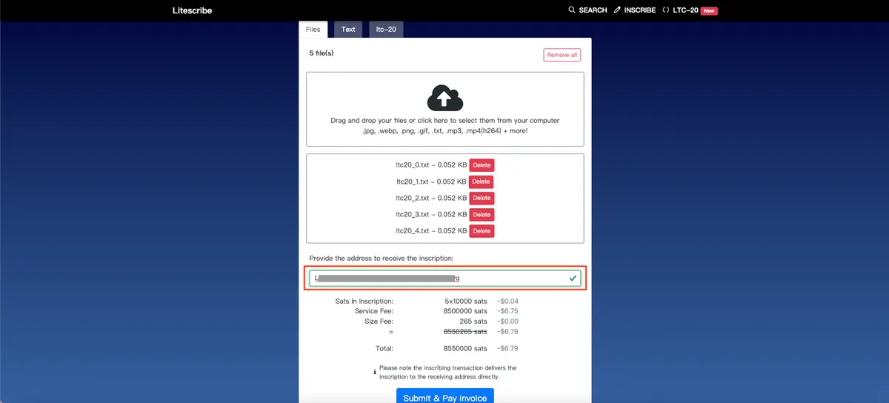
   
7. 接著畫面會顯示此次鑄造所需花費的費用及代鑄造服務的 LTC 收款地址，把地址複製起來

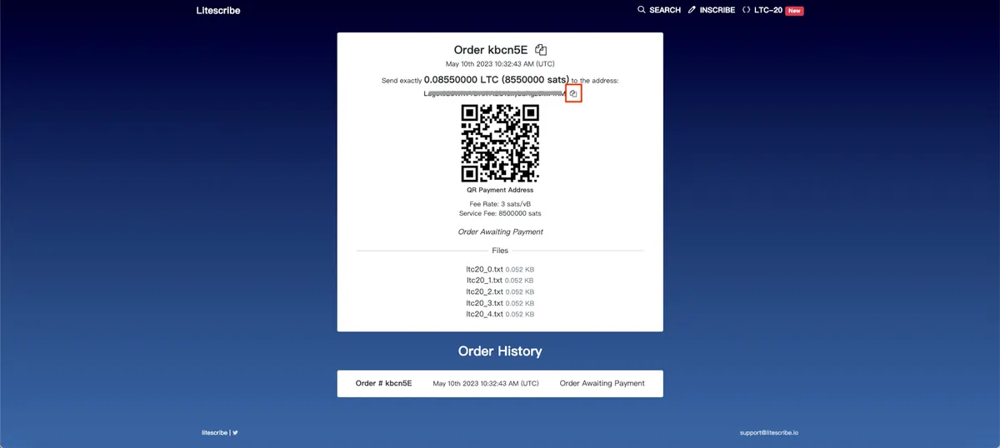

8. 回到錢包頁面，點擊 “SEND”

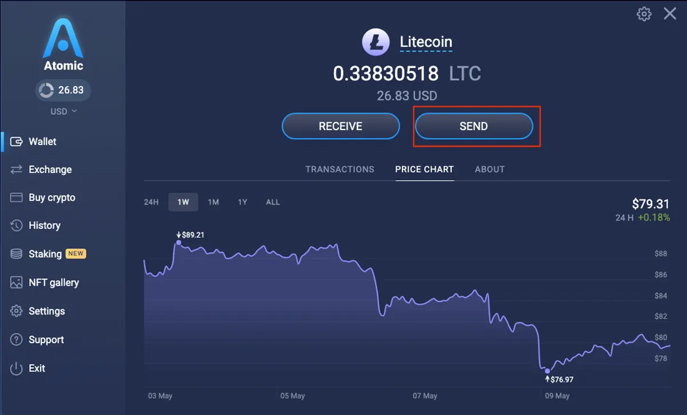

9. 接著把剛才複製的地址貼上來，輸入所需花費的 LTC 數額，輸入完成後點選下方 “SEND”
10. 回到剛才的鑄造頁面，網頁重新整理後會下方就出現剛才的鑄造訂單了
    
    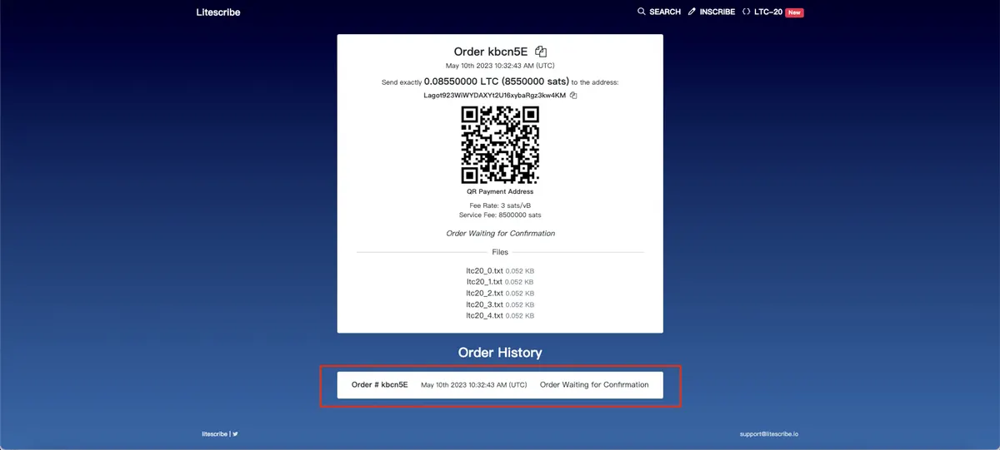
    

> 查詢鑄造結果

為了確認 LTC20 代幣鑄造是否成功，首先打開 LTC 錢包。

1. 點選 “TRANSACTIONS”，然後點擊其中一筆交易紀錄，接著會出現交易的 Hash，把它複製起來。
   
   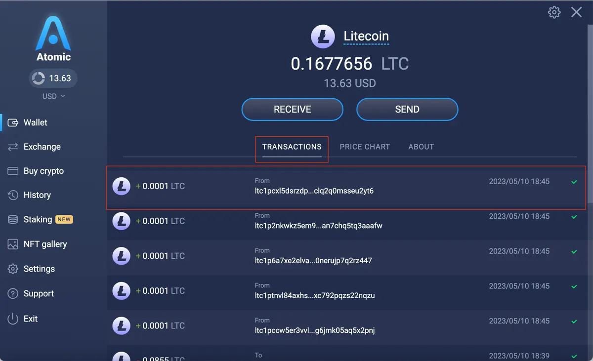
   
2. 進入這個查詢網址：https://ordinalslite.com/
3. 把剛才複製的 Hash 值貼進去搜尋框

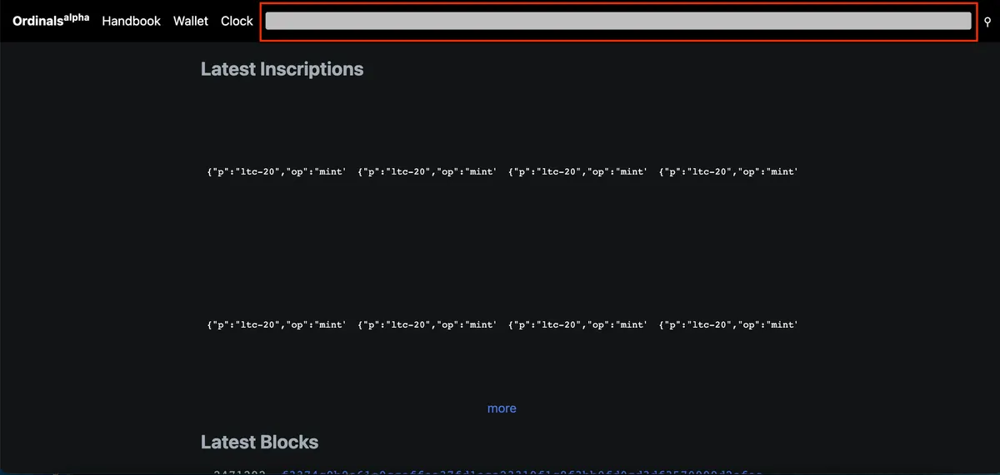

4. 確認下方的 address 地址是不是你的 LTC 地址

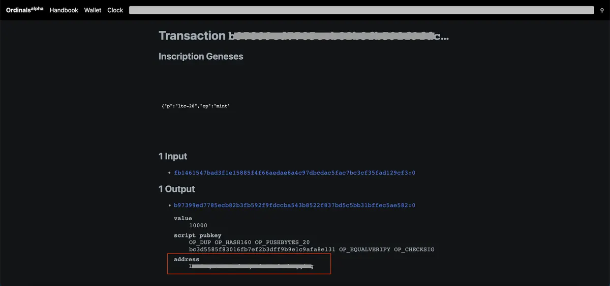

5. 點擊紅框處查看鑄造狀態

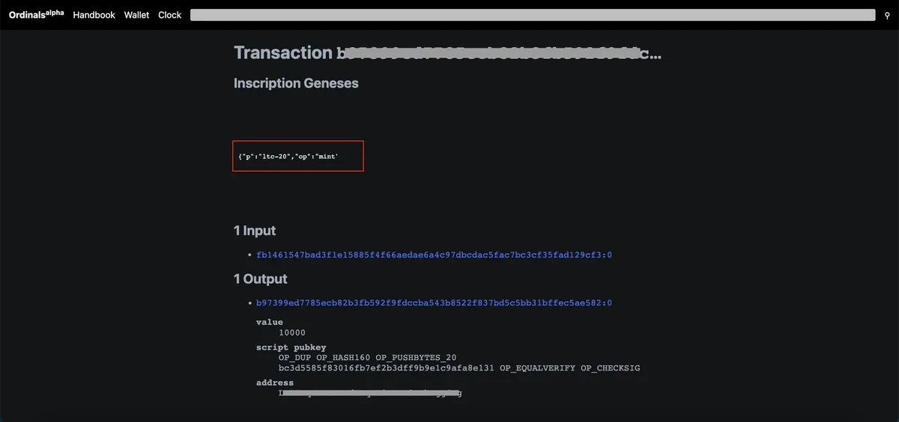

## 小結

現在你已經學會如何鑄造 LTC-20 的代幣，在 LTC 鏈上的費用與 BTC 相比便宜很多，不訪試著鑄造一些代幣，或許你也能重新搭上這波新的浪潮！

感謝您閱讀本篇文章，希望本文的內容能夠對您有所啟發和幫助。

如果您對區塊鏈出圈科普知識感興趣，請搜索 🔍 **[WalkinCat 走路貓](https://portaly.cc/walkincat)**，了解更多相關資訊。如果您想繼續關注我們的最新文章，歡迎訂閱我們的電子報，或透過以下連結找到我們。我們期待您的想法和反饋，謝謝您的支持！

🔥 https://portaly.cc/walkincat
