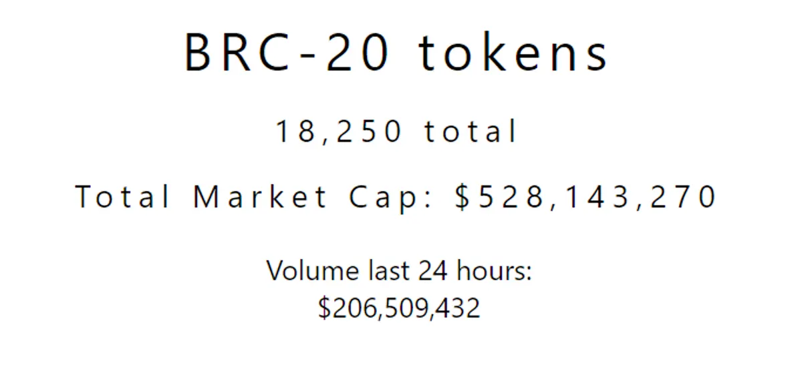
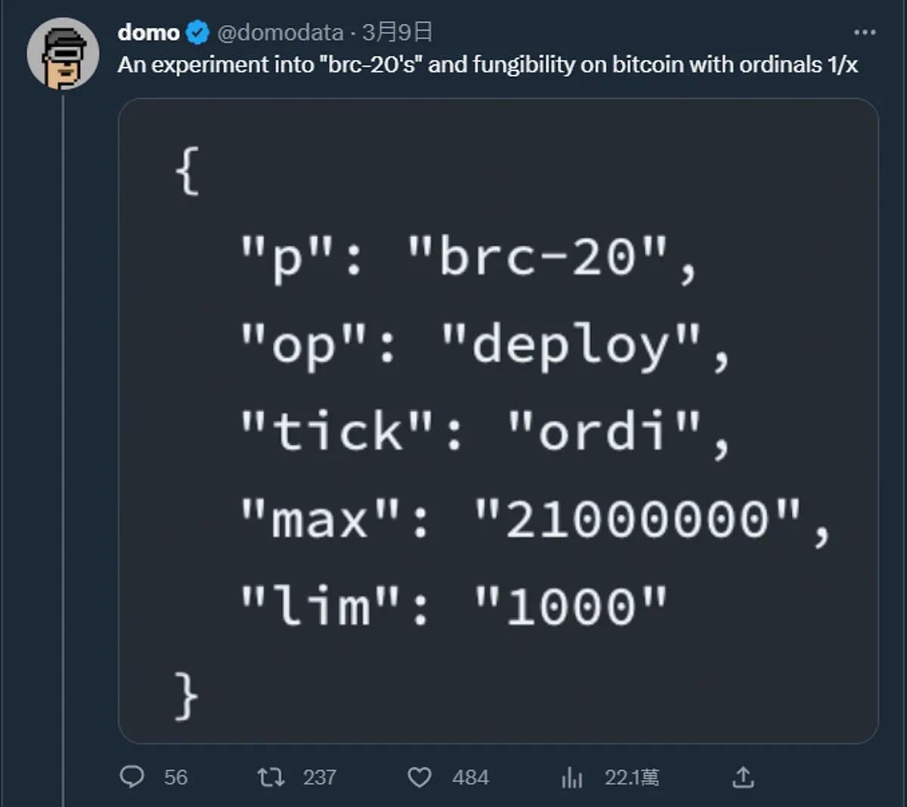
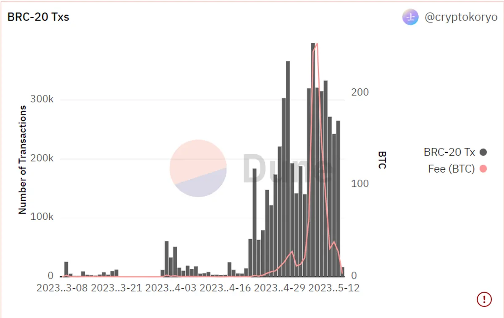

## **概要**

- “**Bitcoin Request for Comment**”（BRC20） 是一種新的、實驗性的代幣標準，用於在比特幣區塊鏈上發行和轉移可替代的代幣。
- BRC20 於 2023 年 3 月首次亮相，使用 Ordinals 協議。
- 截至 2023 年 5 月 9 日，所有 BRC20 代幣的超過 10 億美元。而截至目前（2023 年 5 月 15日，總市值為 5.2 億美元）

https://brc-20.io/



## **介紹**

#### Ordinal

要了解 BRC20 之前，我們必須先了解什麼是 Ordinals protocols，Ordinals 是比特幣的 NFT 實現協議，原先比特幣上是沒有智能合約的，因此要打造 NFT 是有難度的，但 Ordinals 協議允許用戶將 NFT 添加到比特幣交易中，具體的做法源自於比特幣的最小單位 Satoshi（Sats），一顆 Sats = **0.00000001 顆比特幣**，也就是說 1 顆比特幣為 1 億顆 Sats。

Ordinals 協議將「不同的 Satoshi 按照順序編號」為基礎上再往每個 Satoshi 裡寫入數據（如圖片、字串等），由於是最小單位因此不可分割，加上獨一無二的編號，它就變成了「比特幣 NFT」。然而 Ordinals 協議問世之後，比特幣上發布的銘文（inscription）包括圖片、文字，還是沒被大眾所看見，但 BRC20 這個代幣標準的出現改變這一切。

#### 什麼是 BRC20 代幣

部署鑄造銘文，tick 字串用來表示代幣名，max 表示供應量，lim 表示每次轉移最大數額。



BRC20 代幣標準在 2023/3/9 被 Domo （@domdata on Twitter）提出，**他是一個基於 Ordinals 協議的新可互換代幣實驗，BRC20 跟以太坊的 ERC20 沒有任何關聯，可以說是蹭熱度，也可以說是該實驗旨在將以太坊的代幣功能帶入到比特幣中。**

**Domo 的設計利用以 Ordinals 的 JSON 數據包為載體（在比特幣區塊鏈上嵌入 JSON 數據），包含 deploy、mint、transfer 等參數，實現部署、鑄造和轉移代幣，並透過中心化**的鏈下管帳平台管理交易，這種管帳方式與技術比以太坊粗糙許多，但一款加密貨幣成功不僅僅依賴於其技術和實際功能，更依賴其有趣的**敘事**進而推升了共識，正所謂共識面前技術不值一提，價格跟技術不一定有正相關。

> 首個 BRC20 代幣合約部署的是「ordi」代幣，每次鑄幣限制為 1000 個，總量為 2100 萬個。

以下是一些基本的操作

```
##部署
{ 
	"p": "brc-20", 
	"op": "deploy", 
	"tick": "ordi", 
	"max": "21000000", 
	"lim": "1000" 
}
##部署銘文，tick 字串用來表示代幣名，max 表示供應量，lim 表示每次轉移最大數額##
```

```
##鑄造
{
	"p": "brc-20",
	"op": "mint",
	"tick": "ordi",
	"amt": "1000"
}
### amt 不能超過轉移最大數額和餘額 ##
```

```
##轉移
{
	"p": "brc-20",
	"op": "transfer",
	"tick": "ordi",
	"amt": "100",
	"to": "addresses"
}
```

操作非常的簡單，然而當前的功能和服務由於區塊以及前端的不穩定性，各方面還顯得不是很成熟。

#### 如何購買 BRC20 代幣

BRC20 的參與方式除了 mint 之外還可以用買的，撇除掉交易所，BRC20 代幣可以在 [UniSat](https://unisat.io/market) 購買。UniSat Wallet 是一款非託管錢包，具有與 MetaMask 相似的功能，可以用來管理 Ordinals 和 BRC20 的序號，該錢包以開源的 Chrome 擴展功能形式存在，無需運行完整節點就能達成 Ordinals 和 BRC20 的使用，並允許創建、儲存和傳輸 NFT 序號，此外 UniSat 也支援 BRC20 的 Transfer。

由於近期使用者數量激增 UniSat 錢包和網頁目前運行可能較為不順暢，但團隊正在努力優化並改善對外部請求的處理能力。

UniSat 市場目前處於「實驗測試」模式，要求用戶擁有 OG Pass NFT 或累積一定的點數才有資格在平臺上進行交易，手續費也蠻貴的可能會有一些費預期的損耗，使用時需要謹慎。

#### 風險

- 這只是一個實驗，代幣本身並無價值與應用場景
- 只能 deploy、mint、transfer，無法進行更高級操作
- 詐騙與資金盤層出不窮
- BRC20 暴增的交易量大幅增加了比特幣的交易費用
- 不可替代性造成比特幣的貨幣性質減少
- 需要中心化平台管帳，且佔用區塊空間，違背去中心化、擴容的主流敘事
- 去中心化的前提下，BRC20 無法實現智能合約和 DeFi，因為比特幣是沒有智能合約功能的，鏈上的可編程性不足，若要打造在鏈上的金融衍生品，相關的計算操作可能需要透過鏈下的方式來解決，一旦沒有搭配有效的驗證方式，去中心化的特性將被剝奪。
- 流動性不夠成熟，且操作的手續費很高

#### 總結

- BRC20 以銘文的形式，在大帳本中設計了一個小帳本，很像是在一個大國家中搞一個地下組織，讓比特幣的核心擁護者有一些異音。
- 這只是一個實驗性質的代幣，但各方的積極參與和推動讓其發展性十分具有潛力，我們可以期待有朝一日會有更好的升級出現。
- Ordinals 的敘事十分有趣，圖片或文字刻在比特幣上並永久存在的價值是一個大眾容易買單的敘事。
- Ordinals 有關專案的交易量大增，內存池嚴重擁堵造成實際比特幣的交易受阻，威脅到比特幣作為電子現金的核心理念，或許我們可以把那些作為支付的交易利用閃電網路，將用戶資金轉移到鏈下通道中實時結算，交易結束後將最終狀態轉回鏈上清算，減少鏈上的堵塞情況、避免跟 Ordinals 相關專案搶占網路空間，進而去降低暴增的網路費用。

- Meme Tokens 的交易量比有技術的幣種如 Arbitrum（$ARB） 還大，以資本的角度而言，流量跟敘事才是投資人比較關注的內容，有新故事才能拿到新資金。
  
  
  

### 標語

> 記得自己賺取的必須是理智的財富，而不是短視近利的賭博贏得。

DYOR and don't ape in out of FOMO，DYOR 不僅僅是一種建議，而是每一位投資者的責任，在投資新的專案或者產品前我們必須了解該專案的核心價值、長遠的發展潛力、和可能存在的風險；同樣的，我們也不能因為害怕錯過而輕易地跟隨大眾的熱潮，不加思索地投入資金，「愚者千慮，必有一得」長期來看，我們要追求的應該是穩健的收益，而不是短暫的激情。

---

感謝您閱讀本篇文章，希望本文的內容能夠對您有所啟發和幫助。

如果您對區塊鏈出圈科普知識感興趣，請搜索 🔍 **WalkinCat 走路貓**，了解更多相關資訊。如果您想繼續關注我們的最新文章，歡迎訂閱我們的電子報，或透過以下連結找到我們。我們期待您的想法和反饋，謝謝您的支持！

- [訂閱走路貓](https://portaly.cc/walkincat)
