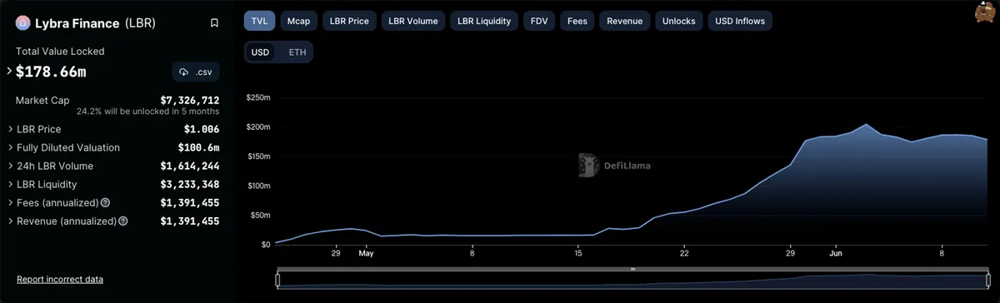
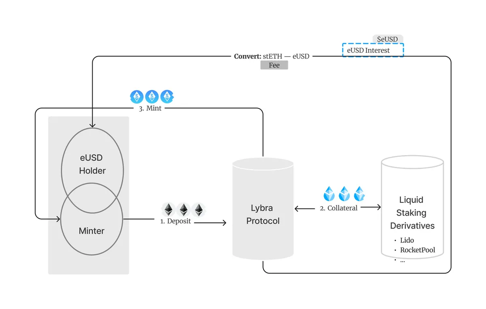
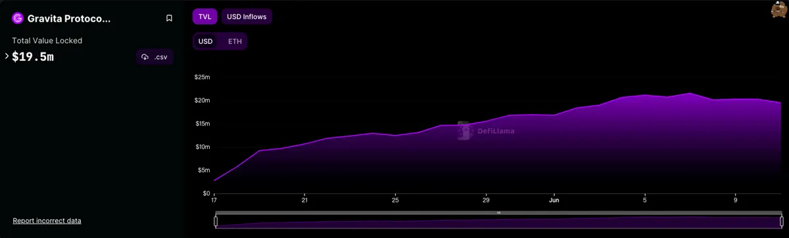
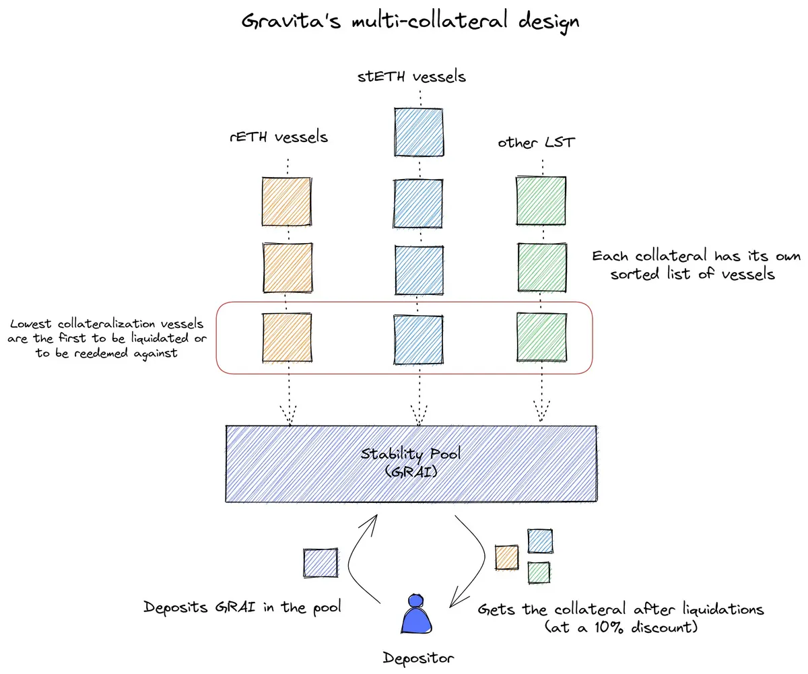
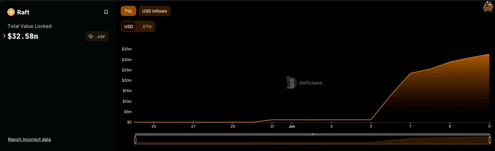
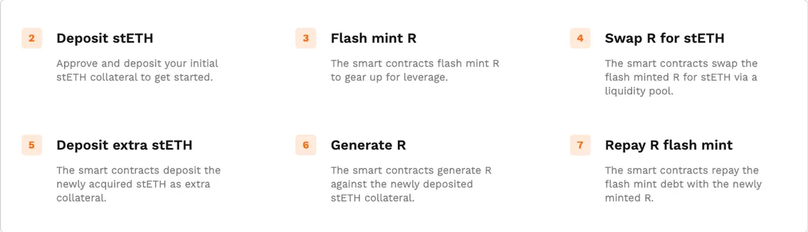
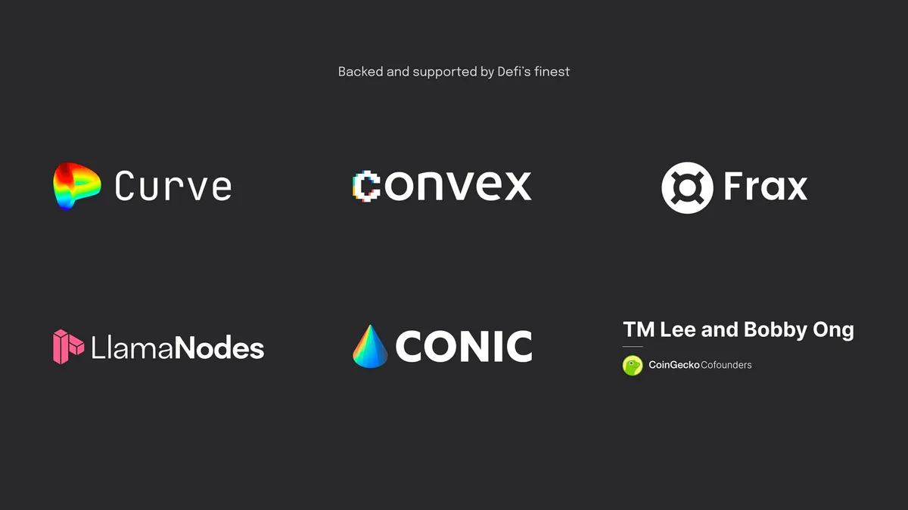
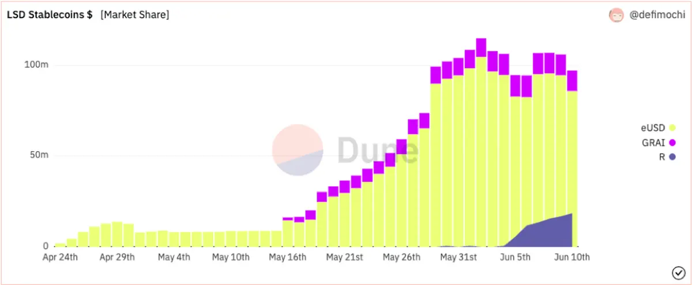
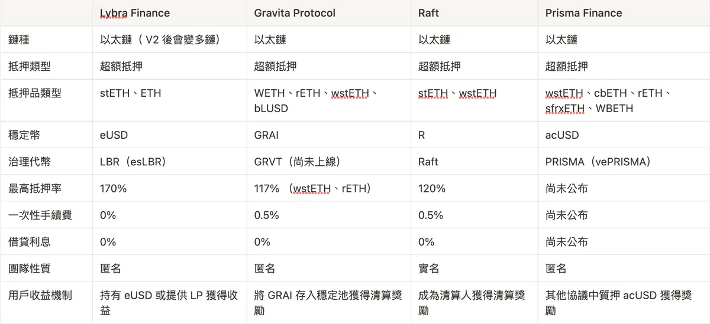

## 前言

雖然當前市場的表現隨著美國監管單位的強力打擊而顯得疲弱不振，不過在這樣的熊市狀況下，LSD 保守穩定的收益加上上海升級後的可提領措施，讓大家對於 LSD 領域的熱情不減反增，不過目前除了在 LSD 協議中找尋較好的以太坊質押收益，許多人也開始把目光看向了 LSDfi 所帶來的新機會。

目前在 LSD 上所有的 TVL 已經達到 180 億美元的規模，可以看出 LSD 已經是 DeFi 應用的重中之重，但如何讓這麼**龐大的流動性擁有更上一層的金融應用**，這時**借貸協議**絕對是最基礎也最重要的 LSDfi 設施。

可以看到最近有許多建立在流動性質押代幣的穩定幣借貸協議開始出現在大眾眼裡，今天文章就要帶大家來一一了解這些 LSDfi 協議究竟是如何爭奪這塊誘人的大餅。

## 介紹

### Lybra Finance

Lybra Finance 自今年 4 月上線以來 TVL 已達到將近 1 億 8000 萬美元，5 月中開始僅僅半個月總鎖倉量就成長了 10 倍以上，速度相當驚人。Lybra Finance 透過抵押 stETH/ETH 鑄造（借款）出可以生息的穩定幣 eUSD，只要持有 eUSD 就能獲得高達 7.2% 以 stETH 為基礎的年化報酬率，並且在鑄造 （借款）時完全沒有借入成本和貸款利息。

Lybra 近日也推出了一個抵押率監控功能，當抵押率低於一定範圍時就會幫用戶自動償還部分債務，避免用戶的抵押品遭到清算，當抵押率恢復時就會自動停止還款機制，算是十分貼心的設計。

Lybra Finance 即將在 7/8 月推出 V2 版本，預計除了會把 eUSD 和其治理代幣 LBR 升級成全鏈的代幣，並新增通縮機制及增加更多 LST 的可抵押類型，也會進一步擴大 eUSD 的應用場景。

### Gravita Protocol

Gravita Protocol 推出將近一個月的時間，目前的 TVL 約為 1900 萬美元，成長的速度不算快，表現算是中規中局。Gravita 是第一個分叉 Liquity 穩定幣借貸協議的專案，只是它改採用 LST 作為借貸的抵押品，其支持的抵押品類型有 WETH、rETH、wstETH、bLUSD，透過抵押這些 LST 來借出 GRAI 穩定幣，其中借款時會有 0.5% 的一次性手續費，若在 6 個月內還款的話，協議則會依比例退還這筆費用，之後整個借款的過程都將沒有額外的利息。

協議中有一個穩定池的機制，用戶可以把借來的 GRAI 存入穩定池（Stability Pool）來賺取收益，這個穩定池主要用來幫助償還被清算倉位（vessels）的債務，而存入 GRAI 到穩定池的用戶則可以得到 10 ％ 折扣價的 LST。

Gravita 也有在官網預告說未來將計劃推出其治理代幣 GRVT，預計可以用來加成收益、降低費用等功能，詳細的細節需留待官方後續的消息發布。

### Raft

Raft 是這個月才剛上線的專案，從推出到現在不到一個禮拜的時間 TVL 就已達到 3200 萬美元，增長速度十分驚人，並且 Raft 尚未推出相關的代幣激勵機制來刺激用戶採用，可見其潛力之大。Raft 是一個完全由 **stETH** 作為價值支撐的穩定幣借貸協議，用戶在借款時會需要支付 0.5% 的一次性費用，後續借款期間一樣不需要支付利息。

Raft 主打的可以最大化用戶的資本效率，協議上的抵押率高達原本高達 110%，因應市場波動的關係，現已調整為 120%，也就是用戶可以擁有高達 6 倍以上的潛在槓桿率，並且 Raft 建立在閃電鑄幣上的一步槓桿功能可以有效降低用戶的交易成本。

Raft 的創辨人透過與在 Curve 上循環借貸放大資金槓桿時的成本比較，說明了 Raft 在這方面的優勢。

[https://twitter.com/davgarai/status/1666687763054317568](https://twitter.com/davgarai/status/1666687763054317568)

Raft 將其前端放在 IPFS 上來確保永久可訪問性和抗審查性，並且合約也是不可變的，藉由這些機制來達到去中心化的願景，不過 Raft 一開始為了協議安全的考量，原本的治理方式是採用內外部成員的 3/5 多簽模式來做到最小化治理，但是合約是不可變的，能調整的只有在協議費用上的設定。

Raft 近日也公布了治理代幣 Raft 的發行計畫，預計會成立 Raft 的治理論壇，並且可以針對協議費用、在哪條鏈部署、新增哪種抵押品類型等有關產品的未來方向來做決策，一步步將治理的模式過渡到真正的去中心化。

### Prisma Finance

Prisam Finance 雖然目前尚未上線，不過從其釋出的專案資訊中可以知道它也是基於 Liquity 分叉出來的穩定幣借貸協議，並且已經受到許多 DeFi 大佬的支持，包括 Curve、Convex 和 Frax 等等。

Prisma 目前支持的抵押品類型有 wstETH、cbETH、rETH、sfrxETH、WBETH，抵押這些 LST 後生成 acUSD 穩定幣。用戶可以在 Curve 和 Convex 上質押借款來的 acUSD 賺取額外的獎勵，包括交易費、CRV、CVX 以及治理代幣 PRISMA。

另外比較特別的是 Prisma 還設置了獨立的抵押品類型研究團隊，他們會對抵押品類型的幾個關鍵條件進行研究，已確認其是否適合 Prisma 協議來支持。

Prisma 採用 vetoken 的經濟模型來讓 vePRISMA 的持有者對協議有更多的治理權，除了在協議費用、抵押品的池參數的治理之外，vePRISMA 的持有人還可以對用哪種抵押品上借款或是有與 Prisma 相關的 LP token 質押者來決定相關的激勵措施，藉此讓發行 LST 的協議能夠成為參與 Prisma 治理的角色之一，機制設計上其實跟 Curve 上的方式十分相似。

### 協議比較

從上圖可以看出目前 Lybra Finance 仍是 LSDfi 穩定幣協議的龍頭，佔據了將近 75% 的市場份額，不過圖表上也可看出 Raft 的市場份額正在高速成長中，是非常有競爭力的後起之秀。

透過以下表格用戶可以清楚知道每個協議之間的差異及優勢，進而選擇適合自己的協議來提升資金使用率並賺取收益，雖然 Prisma Finance 尚未正式上線，但其背靠許多頭部協議的支持，未來對於其他協議的威脅力也不容小覷。

### 總結

越來越多人看見 LSDfi 上的巨大潛力，因此跟其相關的應用也開始如雨後春筍般冒出，甚至原本老牌的 DeFi 協議也漸漸將觸角延伸到 LSDfi 領域，就是為了不放過 LSD 所帶起的龐大市場。而大家對於去中心化穩定幣的關注也隨著前陣子 USDC 事件跟著升高，雖然最後 USDC 平安度過這次危機，但也再次讓許多人意識到去中心化穩定幣必須存在的意義。圍繞在以太坊周圍的生態正在越發的蓬勃，層層交疊起的金融大樓是否能夠承受得起監管與時代的考驗，端看大家對於烏托邦金融世界的共識是否足夠堅定。

---

### 最後感謝

感謝您閱讀本篇文章，希望本文的內容能夠對您有所啟發和幫助。

如果您對區塊鏈出圈科普知識感興趣，請搜索 🔍 **WalkinCat 走路貓**，了解更多相關資訊。如果您想繼續關注我們的最新文章，歡迎訂閱我們的電子報，或透過以下連結找到我們。我們期待您的想法和反饋，謝謝您的支持！

#### 參考資料：

- [https://medium.com/@Lybra\_Finance/lybra-finance-v1-v2-and-the-future-e458d541cc0b](https://medium.com/@Lybra_Finance/lybra-finance-v1-v2-and-the-future-e458d541cc0b)
- [https://mirror.xyz/prismafinance.eth/PClgs5ZMRkbo74E7K1Z8z\_jM5lbbH6FhGSRqQvF55iw](https://mirror.xyz/prismafinance.eth/PClgs5ZMRkbo74E7K1Z8z_jM5lbbH6FhGSRqQvF55iw)
- [https://mirror.xyz/prismafinance.eth/wYAgS4n7aL4tNFdxSed\_m\_5nrNXg\_3yNc18CwBdCyfU](https://mirror.xyz/prismafinance.eth/wYAgS4n7aL4tNFdxSed_m_5nrNXg_3yNc18CwBdCyfU)
- [https://twitter.com/davgarai/status/1666687763054317568](https://twitter.com/davgarai/status/1666687763054317568)
- [https://dune.com/defimochi/lsdfi-summer](https://dune.com/defimochi/lsdfi-summer)
- [https://dune.com/defimochi/lybra-finance](https://dune.com/defimochi/lybra-finance)
- [https://dune.com/the\_datanerd/raft](https://dune.com/the_datanerd/raft)
- [https://docs.raft.fi/faqs/peer-comparison](https://docs.raft.fi/faqs/peer-comparison)
- [https://twitter.com/qiaoyunzi1/status/1665990336177655808](https://twitter.com/qiaoyunzi1/status/1665990336177655808)
