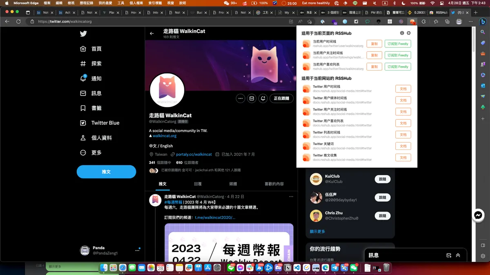
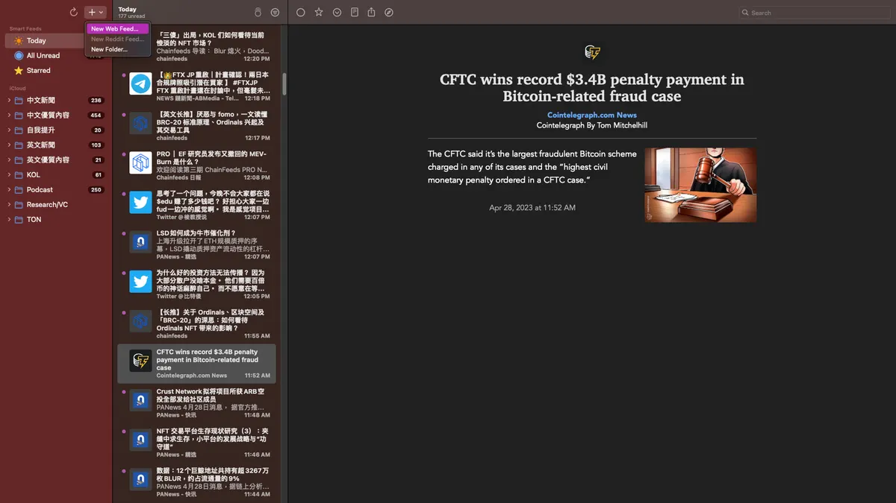
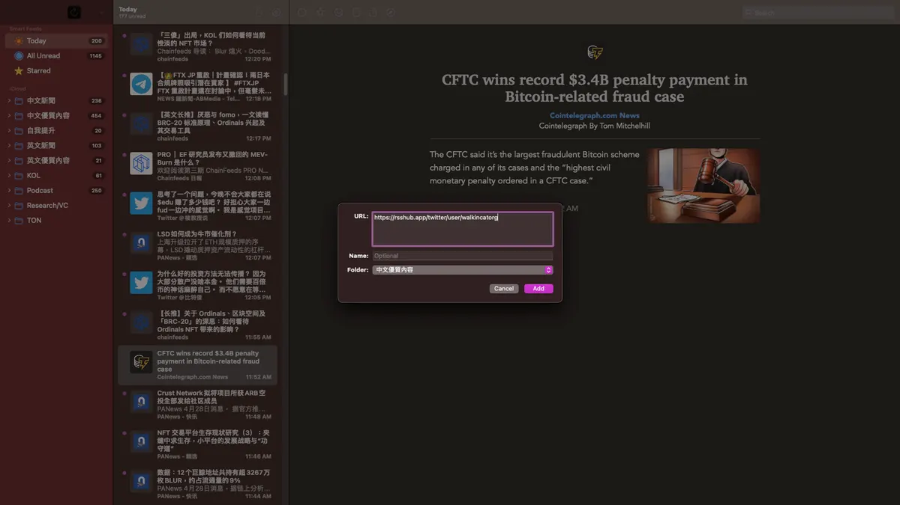

在幣圈這個競爭激烈的市場中，快速獲取並整合有用的外部資訊可能是交易成功的關鍵。由於幣圈資訊不斷更新，投資者需要及時了解關鍵訊息，以作出最好的投資決策。因此，尋找一種可靠而有效的方式，整合外部資訊成為幣圈用戶日常交易的重要步驟。

這時，Rsshub 和 NetNewsWire 這兩個工具的出現，就為幣圈用戶提供了一個強大的方法來收集、整合和分析外部資訊，以便更好地做出投資決策。

## **Rsshub**

Rsshub 是一個開源專案，它可以將各種網站的資訊轉換為 RSS 源。如果您不熟悉 RSS，它是一種用於聚合網站內容的技術。通過訂閱 RSS 源，您可以獲取多個網站上的更新，並將它們放在一個方便的位置。

Rsshub 可以支持許多網站，包括加密貨幣相關的新聞網站，例如 CoinDesk 和 CoinTelegraph。Rsshub 的操作非常簡單，您只需找到您感興趣的網站的 RSS 源，然後添加到 Rsshub 上即可。

使用 Rsshub，您可以將不同網站上的資訊整合在一起，透過 RSS 閱讀器訂閱它們，這樣您就可以在一個地方看到所有的重要訊息，無需逐個查看網站。

> 💡 **Rsshub 還有個額外強大的功能，就是他可以創建 RSS 源**。

## **NetNewsWire**

NetNewsWire 是一個強大的 RSS 閱讀器，它可以讓您輕鬆地訂閱和管理 RSS 源。它支持各種操作系統，包括 macOS、iOS 和 iPadOS。如果您是一位幣圈用戶，NetNewsWire 可能是您日常交易中必不可少的工具。您只需在 NetNewsWire 中添加您想要的 RSS 源，它就會自動更新並顯示新的內容。

NetNewsWire 還具有一些其他有用的功能，例如標籤、篩選器和全文檢索。這些功能可以幫助您更有效地管理和查找關鍵訊息。

> https://netnewswire.com/

但如果你是 Windows 用戶，推薦大家可以用 Feedly 或是其他的 RSSReader，最主要是 **NetNewsWire** 可以免費收集無限多 RSS 源，但 Feedly 或是其他的 RSSReader 通常都有限制 100-150 個左右。

## **整合 Rsshub 和 NetNewsWire**

現在，我們已經了解了 Rsshub 和 NetNewsWire 這兩個工具，讓我們看看如何整合它們以便更好地了解幣圈資訊。

首先，您需要在 Rsshub 上找到您感興趣的網站的 RSS 源，然後添加到 NetNewsWire 中。接下來，您可以瀏覽和查看所有訂閱的 RSS 源，以快速了解幣圈的動態和新聞。

如果您使用多個 RSS 源，則可以使用 NetNewsWire 的分類功能將它們分組，這樣您就可以更輕鬆地管理它們。您還可以使用標籤、篩選器和全文檢索功能來更快地找到您需要的資訊。

另一個好處是，這些工具也可以在您離線時提供有用的訊息。您只需在網路上訂閱 RSS 源，然後下載到 NetNewsWire，您就可以在沒有網路的情況下查看它們。這在旅行或沒有 Wi-Fi 的地方非常有用。

## 實作 Rsshub 整合 NetNewsWire

### 第一步、下載 Rsshub 插件

> [RSSHub Radar](https://chrome.google.com/webstore/detail/rsshub-radar/kefjpfngnndepjbopdmoebkipbgkggaa)

### 第二步、至走路貓的 Twitter 或是任意你想要加入追蹤來源的網站

### 第三步、點選複製當前用戶時間線貼至 NetNewsWire

### **結論**

在這篇文章中，我們介紹了 Rsshub 和 NetNewsWire 這兩個工具，它們可以幫助幣圈用戶更有效地整合外部資訊。通過使用這些工具，您可以方便地訂閱和管理多個 RSS 源，以快速了解幣圈的動態和新聞。此外，這些工具還具有其他有用的功能，例如分類、標籤、篩選器和全文檢索，可以幫助您更好地管理和查找關鍵訊息。

如果您是幣圈用戶，我強烈建議您試試這些工具。它們不僅可以幫助您節省時間，還可以提供有用的訊息，幫助您做出更好的投資決策。

---

感謝您閱讀本篇文章，希望本文的內容能夠對您有所啟發和幫助。

如果您對區塊鏈出圈科普知識感興趣，請搜索 🔍 **WalkinCat 走路貓**，了解更多相關資訊。如果您想繼續關注我們的最新文章，歡迎訂閱我們的電子報，或透過以下連結找到我們。我們期待您的想法和反饋，謝謝您的支持！

- [訂閱走路貓](https://portaly.cc/walkincat)
- [加入走路貓的電報（Telegram）討論群](https://t.me/walkincat/1)
- [走路貓 Reels](https://www.instagram.com/p/Cs_CgAPg3Xr/)
